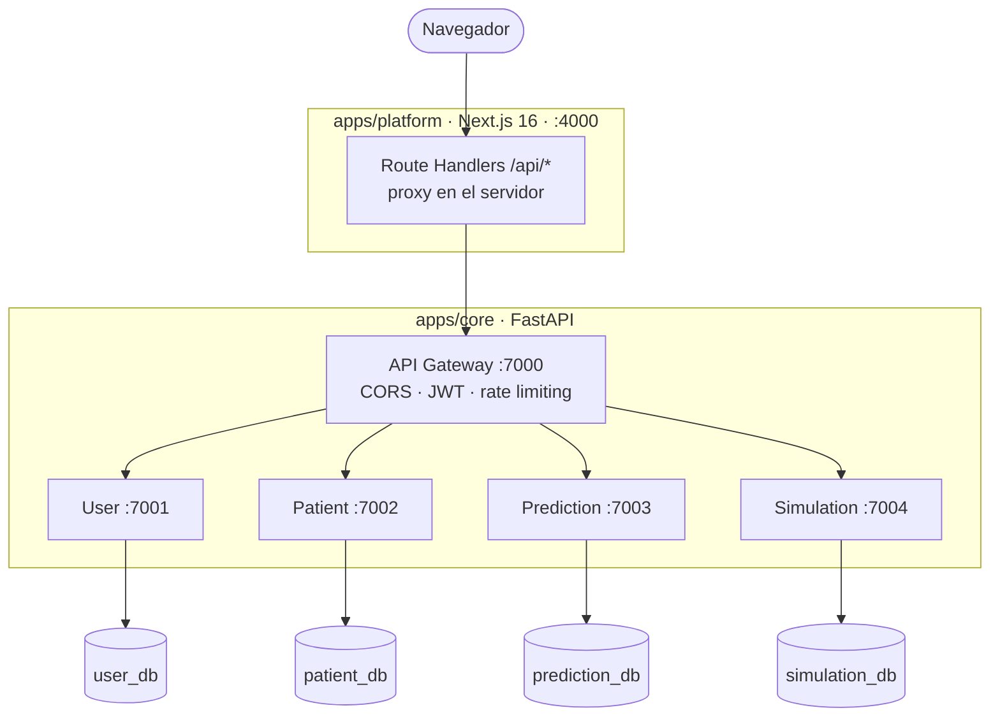

# SADUCI

Sistema de Ayuda a la Decisión en la Unidad de Cuidados Intensivos — Hospital
Universitario Arnaldo Milián Castro.

Monorepo con 5 microservicios Python (puertos 7000-7004), un cliente web
Next.js y una biblioteca compartida (`shared_core`).

## Arquitectura



| Servicio | Puerto | Base de datos | Responsabilidad |
|----------|--------|---------------|-----------------|
| API Gateway | 7000 | — | Enrutado, CORS, emisión/validación de JWT, rate limit |
| User | 7001 | `user_db` | Usuarios, registro, login, perfiles |
| Patient | 7002 | `patient_db` | Registro clínico de pacientes (async) |
| Prediction | 7003 | `prediction_db` | Motor de predicción (modelo ML) |
| Simulation | 7004 | `simulation_db` | Simulación ICU (SimUCI + fallback estadístico) |
| Platform | 4000 | — | Cliente web Next.js |

Los 4 microservicios de datos **no se exponen públicamente**: internamente
escuchan en `127.0.0.1` y solo el gateway y el frontend son alcanzables.

## Estructura

| Ruta | Contenido |
|------|-----------|
| `apps/core/src/api-gateway/` | Gateway: `app/{api,controllers}` |
| `apps/core/src/user/` | `app/{api,schemas,services,repositories,models}` |
| `apps/core/src/patient/` | idem (async, `create_async_engine`) |
| `apps/core/src/prediction/` | idem + `models/v1/new_workflow.joblib` |
| `apps/core/src/simulation/` | idem + `app/data/centroids.csv` |
| `apps/core/src/shared_core/` | Biblioteca compartida: `security`, `exceptions`, `database`, `schemas/`, `utils/` |
| `apps/core/tests/` | Tests del backend (un subprocess por servicio) |
| `apps/core/compose.yaml` | Docker Compose del backend y sus bases de datos |
| `apps/core/.env` | Secretos del despliegue (no se versiona) |
| `apps/platform/` | Cliente web (Next.js 16, React 19, Tailwind v4, Bun) |
| `scripts/` | `saduci.py` (único orquestador) y `fix_db_permissions.py` |
| `docs/sistema/` | Documentación técnica: arquitectura, API, despliegue, ejecución |
| `docs/tesis/` | Escribos y diagramas de la tesis |

Cada servicio usa **MVC**: `api/` (rutas) → `services/` (lógica) →
`repositories/` (persistencia) → `models/` (SQLAlchemy).

`shared_core` está **duplicado**: una copia canónica en
`apps/core/src/shared_core/` y una copia por servicio. Las copias existen
porque Docker no puede hacer `COPY` fuera del contexto de build. `saduci.py up`
las mantiene sincronizadas; si lo editas, edita el canónico y vuelve a lanzar.

## Levantar cada aplicación por separado

Cada aplicación se levanta desde su propio directorio, sin orquestador:

```bash
# Backend + bases de datos (gateway, 4 microservicios, 4 Postgres)
cd apps/core
cp .env.example .env        # solo la primera vez
docker compose up --build

# Frontend, en otra terminal
cd apps/platform
bun install                 # solo la primera vez
bun run dev
```

Con eso quedan:

| Servicio | URL |
|---|---|
| Frontend | http://localhost:4000 |
| API Gateway (docs `/docs`) | http://localhost:7000 |
| User | http://localhost:7001 |
| Patient | http://localhost:7002 |
| Prediction | http://localhost:7003 |
| Simulation | http://localhost:7004 |

**Login:** `admin` / `changeme`

`docker compose up` en `apps/core` levanta **solo el backend y las bases**: el
frontend tiene su propio ciclo de vida, así que su recarga en caliente y sus
logs se ven directamente en la terminal. El perfil `platform` existe para el
despliegue completo en un servidor (`docker compose --profile platform up -d`).

## Orquestador (opcional)

`saduci.py` levanta y valida el sistema entero sin Docker. Por defecto queda en
**primer plano**: muestra el arranque paso a paso y luego converge los logs de
todos los servicios en la misma terminal, con el nombre de cada uno.

```bash
python scripts/saduci.py up                # primer plano, logs en vivo (Ctrl+C detiene)
python scripts/saduci.py up --detach       # segundo plano
python scripts/saduci.py up backend        # solo el backend
python scripts/saduci.py up platform       # solo el frontend
python scripts/saduci.py logs --follow     # seguir los logs de todos los servicios
python scripts/saduci.py down              # detener
```

Otros comandos: `check`, `logs`, `test`, `dbfix`, `secrets`, `deploy-check`.
También como atajos: `make up`, `make up-detach`, `make logs-follow`.

## Instalación de Docker (para desplegar)

Sólo hace falta si vas a desplegar con Compose. Para desarrollo local no lo
necesitas: `saduci.py up` corre los servicios con Python y `bun`.

**Linux (recomendado para servidor) — Docker Engine:**

```bash
curl -fsSL https://get.docker.com -o get-docker.sh
sudo sh get-docker.sh
sudo systemctl enable --now docker
sudo usermod -aG docker "$USER"   # cierra sesión y vuelve a entrar
docker compose version
```

**Windows / macOS — Docker Desktop:**

Instala Docker Desktop desde <https://docs.docker.com/desktop/> y actívalo.
En Windows además requiere la característica opcional **Containers**:
*Configuración → Aplicaciones → Funcionalidades opcionales → Agregar
"Containers"* y reiniciar. Docker Desktop lo instala por ti; Engine por
cuenta sola no funciona bien en Windows con Hyper-V.

En Windows, si prefieres solo Engine (sin GUI) y ya tienes WSL2:

```powershell
wsl --install -d Ubuntu
wsl --set-default-version 2
winget install -e --id Docker.DockerDesktop
```

## Despliegue en un servidor

```bash
cp apps/core/.env.example apps/core/.env
python3 scripts/saduci.py secrets        # secretos reales
python3 scripts/saduci.py deploy-check   # valida antes de desplegar
cd apps/core && docker compose --profile platform up -d --build
```

Guía completa (requisitos, verificación, respaldos, updates, HTTPS) en
**[docs/sistema/DEPLOY.md](docs/sistema/DEPLOY.md)**.

## Verificación

| Qué | Comando |
|-----|---------|
| Estado del sistema | `python scripts/saduci.py check` |
| Tests del backend | `python scripts/saduci.py test` (o `make test`) |
| Tests del frontend | `cd apps/platform && bun test` |
| Tipos del frontend | `cd apps/platform && bunx tsc --noEmit` |
| Lint del frontend | `cd apps/platform && bun run lint` |
| Coherencia del deploy | `python scripts/saduci.py deploy-check` |

La suite de tests del backend lanza **un subprocess por servicio**: cada uno es
un paquete raíz `app` independiente y dos no pueden coexistir en el mismo
intérprete.

## Documentación

- Ejecución local: [docs/sistema/RUNNING.md](docs/sistema/RUNNING.md)
- Arquitectura: [docs/sistema/ARCHITECTURE.md](docs/sistema/ARCHITECTURE.md)
- API: [docs/sistema/API_ENDPOINTS.md](docs/sistema/API_ENDPOINTS.md)
- Despliegue en servidor: [docs/sistema/DEPLOY.md](docs/sistema/DEPLOY.md)
- Escribos de tesis: `docs/tesis/`
- Metodología de agentes de IA: [docs/ai/](docs/ai/)
