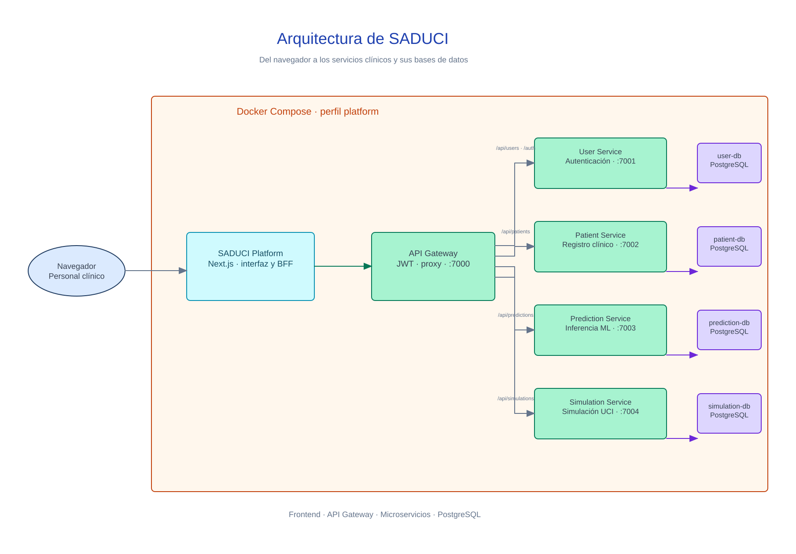

# SADUCI

Sistema de Ayuda a la Decisión en la Unidad de Cuidados Intensivos. Proyecto
desarrollado en el contexto del Hospital Universitario Arnaldo Milián Castro.

[Read the documentation in English](docs/README.md).

## SADUCI (resumen)

SADUCI es una aplicación web que ayuda al personal clínico a consultar
información de pacientes, revisar predicciones y explorar simulaciones de
cuidados intensivos. La plataforma reúne un frontend Next.js y cuatro servicios
de backend independientes.

## Arquitectura

El diagrama editable está en formato Excalidraw. La vista previa PNG se muestra
aquí mismo en GitHub; haz clic para abrir el archivo editable. Consulta la
[documentación técnica de arquitectura](docs/sistema/ARCHITECTURE.md).

[](docs/sistema/diagramas/arquitectura-saduci.excalidraw)

## Servicio

El backend usa FastAPI y PostgreSQL. El frontend usa Next.js, React y Bun. Cada
servicio de datos mantiene su propia base de datos.

| Servicio | Puerto | Función |
| --- | ---: | --- |
| API Gateway | 7000 | Autenticación, control de acceso y enrutado |
| User Service | 7001 | Usuarios y roles |
| Patient Service | 7002 | Registro de pacientes |
| Prediction Service | 7003 | Predicciones y explicaciones |
| Simulation Service | 7004 | Simulaciones y pruebas estadísticas |

Para iniciar el backend con Docker, copia el archivo de entorno y levanta los
servicios desde `apps/core`:

```bash
cd apps/core
cp .env.example .env
docker compose up --build
```

Inicia el frontend en otra terminal:

```bash
cd apps/platform
bun install
bun run dev
```

La interfaz queda disponible en `http://localhost:4000` y el API Gateway en
`http://localhost:7000`. Para desarrollo sin Docker, consulta la
[guía de ejecución local](docs/sistema/RUNNING.md). La
[guía de despliegue](docs/sistema/DEPLOY.md) contiene los pasos para un servidor.

## Uso Médico

SADUCI ayuda al personal clínico a valorar información y tomar decisiones. No
sustituye el criterio profesional ni los protocolos clínicos de la institución.

La documentación del proyecto indica que la implementación predictiva actual
no está validada para uso clínico prospectivo. Sus resultados no deben
interpretarse como diagnósticos ni como garantía de desenlaces. Consulta el
[estudio de integración del modelo](docs/sistema/INTEGRATION_PLAN_2026.md) y el
[estudio del modelo local de explicaciones](docs/sistema/ESTUDIO_MODELO_LOCAL.md)
para conocer el alcance y las limitaciones documentadas.

## Investigación

La documentación académica está organizada por capítulos:

- [Índice del capítulo 2](docs/tesis/capitulo-2/INDICE.md)
- [Índice del capítulo 3](docs/tesis/capitulo-3/INDICE.md)
- [Diagramas de tesis](docs/tesis/capitulo-2/diagramas/README.md)
- [Estudios y documentos técnicos](docs/sistema/)

La investigación y la evaluación de modelos deben conservar sus datos,
versiones y limitaciones documentadas. No incorpores datos clínicos al
repositorio sin autorización y revisión de privacidad.

## Licencia

Código disponible públicamente para consulta. No se concede una licencia para
usar, modificar ni redistribuir SADUCI. Todos los derechos reservados.
