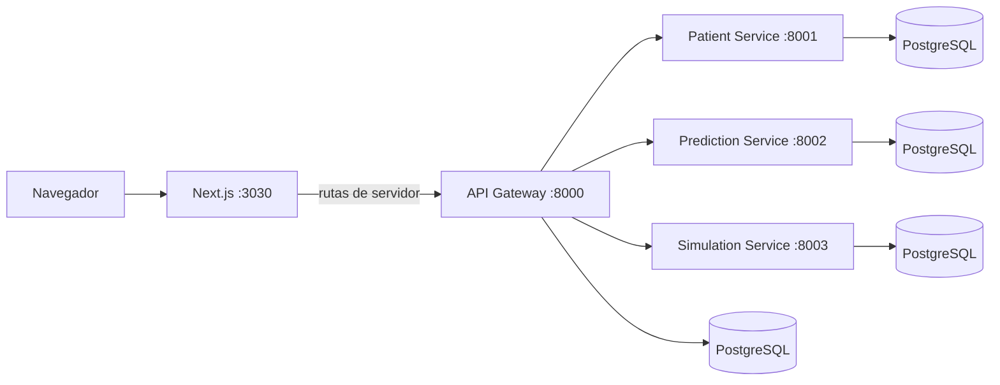

# Arquitectura de SADUCI-T

SADUCI-T reúne una aplicación Next.js y cuatro servicios FastAPI. El frontend atiende la interfaz y sus rutas de servidor. El API Gateway autentica usuarios y enruta las operaciones clínicas hacia los servicios de pacientes, predicción y simulación.

## Estructura del proyecto

```text
saduci-t/
├── docs/                 Documentación general y guías de cada componente
├── render.yaml           Configuración de despliegue para Render
└── src/
    ├── frontend/         Aplicación Next.js
    └── backend/          Servicios FastAPI y Docker Compose
```

El frontend y el backend conservan sus propios manifiestos y dependencias. Sus rutas de código son relativas a cada componente. Los archivos de orquestación y la documentación general viven en la raíz.

## Componentes y comunicación



| Componente | Ruta de código | Responsabilidad |
| --- | --- | --- |
| Frontend | [`src/frontend/`](../src/frontend/) | Renderiza las páginas y usa Route Handlers de Next.js para el API y la configuración dinámica de páginas. |
| API Gateway | [`src/backend/src/api-gateway/main.py`](../src/backend/src/api-gateway/main.py) | Gestiona autenticación, usuarios y solicitudes hacia los servicios internos. |
| Patient Service | [`src/backend/src/patient/main.py`](../src/backend/src/patient/main.py) | Crea, consulta y actualiza pacientes. |
| Prediction Service | [`src/backend/src/prediction/main.py`](../src/backend/src/prediction/main.py) | Ejecuta predicciones, explica resultados y guarda el historial. |
| Simulation Service | [`src/backend/src/simulation/main.py`](../src/backend/src/simulation/main.py) | Ejecuta simulaciones clínicas y pruebas estadísticas. |

El frontend obtiene la dirección del gateway mediante `API_URL`. Las llamadas salen desde los Route Handlers del servidor Next.js, de modo que esa URL no necesita exponerse al navegador. La configuración de cliente vive en [`src/frontend/src/app/api/`](../src/frontend/src/app/api/).

Las rutas `/api/page-configs` leen y escriben `data/page-configs.json` dentro del directorio de trabajo del frontend. Ese archivo se ignora en Git y queda en el sistema de archivos local.

## Responsabilidades del API Gateway

El gateway valida credenciales, emite y comprueba tokens JWT, gestiona usuarios y reenvía solicitudes a los servicios internos. También conserva rutas de compatibilidad para las operaciones que consume el frontend.

Las rutas principales incluyen:

- Autenticación: `/auth/login`, `/auth/register`, `/auth/me` y `/auth/change-password`.
- Administración: `/admin/users` y `/api/users`.
- Pacientes: `/api/patients`.
- Predicciones: `/api/predictions` y `/prediction`.
- Simulaciones: `/api/simulations`, `/simulation` y `/simulations/icu`.
- Estadística: `/statistics/wilcoxon` y `/statistics/friedman`.

El gateway usa sus propias credenciales de base de datos para la autenticación y los usuarios. Los servicios de pacientes, predicción y simulación tienen bases PostgreSQL separadas.

## Servicios clínicos

### Pacientes

El Patient Service expone comprobación de salud y operaciones para crear, consultar y actualizar pacientes. El gateway llama al servicio en `http://patient:8001` dentro de la red de Compose.

### Predicciones

El Prediction Service ofrece predicciones clínicas y consulta el historial por paciente. También acepta las rutas `/prediction` y `/prediccion` para compatibilidad con el frontend. El artefacto del modelo está en [`src/backend/src/prediction/models/v1/new_workflow.joblib`](../src/backend/src/prediction/models/v1/new_workflow.joblib).

La explicación puede devolver contribuciones por variable. La generación opcional de narrativa depende de `PREDICTION_NARRATIVE_PROVIDER` y sus variables asociadas.

### Simulaciones y estadística

El Simulation Service ejecuta escenarios clínicos, la integración disponible con SimUCI y pruebas Wilcoxon y Friedman. Expone tanto rutas de servicio como las rutas de compatibilidad que usa el frontend.

## Datos y persistencia

[`src/backend/docker-compose.yml`](../src/backend/docker-compose.yml) define ocho contenedores: cuatro servicios FastAPI y cuatro bases PostgreSQL. Cada base pertenece a un servicio. Compose espera a que las bases y los servicios dependientes pasen sus comprobaciones de salud.

Las bases no publican puertos al host. El gateway publica el puerto `8000`; los servicios clínicos se enlazan a `127.0.0.1` en los puertos `8001`, `8002` y `8003`.

## Desarrollo y despliegue

El README raíz explica cómo configurar las variables y ejecutar el stack. Las guías específicas están en [`docs/frontend/README.md`](frontend/README.md) y [`docs/backend/README.md`](backend/README.md).

[`render.yaml`](../render.yaml) define servicios para el API Gateway, Prediction Service y Simulation Service. La pila local de Compose también incluye el Patient Service y las cuatro bases de datos.

La [arquitectura del backend](backend/ARCHITECTURE.md) describe las rutas y responsabilidades de cada servicio.

## Ubicaciones de referencia

- Frontend: [`src/frontend/`](../src/frontend/)
- Backend: [`src/backend/`](../src/backend/)
- Compose: [`src/backend/docker-compose.yml`](../src/backend/docker-compose.yml)
- Configuración de Render: [`render.yaml`](../render.yaml)
- Variables de entorno de ejemplo: [`src/backend/.env.example`](../src/backend/.env.example) y [`src/frontend/.env.example`](../src/frontend/.env.example)

## Flujo de simulación en el frontend

La página `src/frontend/src/app/simulation/page.tsx` mantiene los campos del escenario y el historial en memoria durante la sesión de la página. Cada ejecución conserva su identificador, fecha, parámetros y respuesta; editar el escenario o iniciar un caso nuevo no modifica las ejecuciones anteriores. Las exportaciones usan los datos de la ejecución seleccionada.

`SimulationInputs` compone un formulario con datos clínicos y un panel de ejecución. Los campos se bloquean mientras hay una solicitud activa. Los resultados anteriores siguen disponibles durante el cálculo. La interfaz muestra tiempo transcurrido, ya que el servicio no ofrece progreso medido.

El cliente llama a `/api/simulation`, cuyo Route Handler reenvía el formato compacto a `/simulation` del gateway. La espera tiene un límite de seis minutos. Cancelar aborta la espera y la petición saliente desde Next.js; no garantiza detener el cálculo del servicio clínico.
