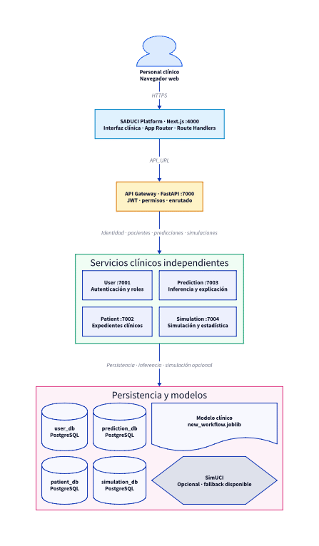
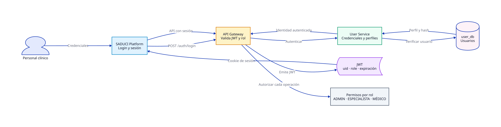
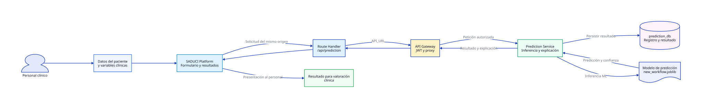
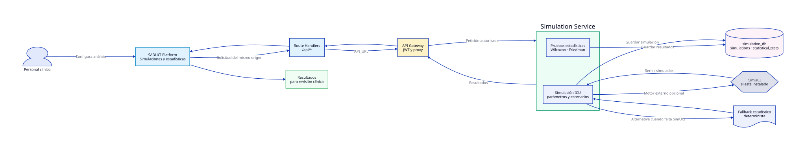
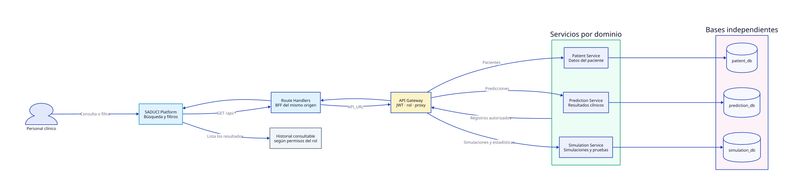

# SADUCI documentation

This page provides an English overview of SADUCI. The
[main README](../README.md) and the detailed system documentation are in Spanish.

## SADUCI (overview)

SADUCI is a clinical decision support system for intensive care. It helps
clinical staff review patient information, predictions, and ICU simulations. It
does not replace professional judgment or institutional clinical protocols.

## Architecture

The architecture is declared in D2 and animated vertically from the web
interface down to the service databases. The
[architecture reference](sistema/ARCHITECTURE.md) documents the system in more
detail.



The editable source is
[arquitectura-general.d2](sistema/diagramas/arquitectura-general.d2). The module
diagrams explain authentication, prediction, simulation, and patient records.






## Services

The web client uses Next.js, React, and Bun. The backend uses FastAPI and
PostgreSQL. Each data service has its own database.

| Service | Port | Responsibility |
| --- | ---: | --- |
| API Gateway | 7000 | Authentication, access control, and routing |
| User Service | 7001 | Users and roles |
| Patient Service | 7002 | Patient records |
| Prediction Service | 7003 | Predictions and explanations |
| Simulation Service | 7004 | ICU simulations and statistical tests |

To start the backend with Docker, copy the example environment file and run
Compose from `apps/core`:

```bash
cd apps/core
cp .env.example .env
docker compose up --build
```

Start the web client in a separate terminal:

```bash
cd apps/platform
bun install
bun run dev
```

The web client is available at `http://localhost:4000`. The API Gateway is
available at `http://localhost:7000`. See the
[local run guide](sistema/RUNNING.md) and the
[deployment guide](sistema/DEPLOY.md) for more options.

## Medical use

SADUCI helps clinical staff assess information and make decisions. The current
predictive implementation has not been validated for prospective clinical use.
Do not treat its output as a diagnosis or a guarantee of patient outcomes. Read
the [model integration study](sistema/INTEGRATION_PLAN_2026.md) and the
[local explanation model study](sistema/ESTUDIO_MODELO_LOCAL.md) for the stated
scope and limitations.

## Research

The academic documentation is organized by thesis chapter:

- [Chapter 2 index](tesis/capitulo-2/INDICE.md)
- [Chapter 3 index](tesis/capitulo-3/INDICE.md)
- [Thesis diagrams](tesis/capitulo-2/diagramas/README.md)
- [System studies and technical documents](sistema/)

Do not add clinical data to this repository without authorization and a privacy
review. Record the data source, model version, evaluation method, and known
limitations in research materials.

## License

The source code is publicly available for viewing. No license is granted to use,
modify, or redistribute SADUCI. All rights reserved.
