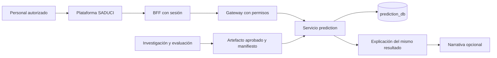

# Estudio y plan de integración del modelo de mortalidad en SADUCI

Fecha de revisión: 9 de noviembre de 2026. Estado: estudio y primera entrega técnica.

La primera entrega consolida el modelo actual en SADUCI, Sistema de Ayuda a la
Decisión en la Unidad de Cuidados Intensivos. La detección temprana se planifica
después, como una evolución con variables y evaluación propias. Esta secuencia
fue confirmada por el responsable del proyecto durante el estudio.

La integración predictiva ya existe. El trabajo pendiente consiste en alinear
entradas, método de explicación, identidad del usuario, persistencia y versiones.
Copiar nuevamente el modelo o trasladar toda la aplicación Streamlit no resuelve
esas diferencias.

## 1. Referencias y alcance

| Proyecto | Revisión de referencia | Función en la integración |
| --- | --- | --- |
| `Intensive-Care-Hidden-Mortality` | `2cf81403b3ce9390618df3cd2e7a43082506c5c3` | Origen de los experimentos, artefactos y prototipo. |
| `Intensive-Care-Hidden-Mortality-SADUCI-Integration` | `e80032ed975e136f27b86a257238572a511051ba` | Fork que incorpora el resumen histórico y el informe previo de transferencia. |
| `saduci` | `0553b3b0e82dcb3584b6662e1417a070530879df` | Destino de ejecución y de este plan operativo. |

El fork añade `Summary2026.md` e `IntegracionSADUCI2026.md` respecto al commit del
original. Su diferencia versionada no incorpora cambios de código predictivo.
Las tres copias de `new_workflow.joblib` tienen este SHA-256:

```text
b58bcf14ff4ad023c608861323bcabca5fa5d9250058af9f1ed1d0e1cf1923ad
```

La identidad binaria está comprobada. La paridad de ejecución entre entornos
todavía necesita una prueba con entradas iguales y dependencias identificadas.
Además, el cargador permite `PREDICTION_MODEL_PATH` y varias rutas alternativas,
por lo que el archivo versionado no demuestra qué artefacto usa un proceso activo.

Se consultaron estos antecedentes:

- [Summary2026 del proyecto de investigación](../../../Intensive-Care-Hidden-Mortality-SADUCI-Integration/Summary2026.md), especialmente sus apartados 3, 7, 9 y 14.
- [Informe previo de integración](../../../Intensive-Care-Hidden-Mortality-SADUCI-Integration/IntegracionSADUCI2026.md), que propone consolidar el servicio existente.
- [Arquitectura de SADUCI](ARCHITECTURE.md) y [estudio del generador local](ESTUDIO_MODELO_LOCAL.md).

En los archivos versionados locales revisados, `Summary2026.md` está en el fork.
No se encontró otro archivo con ese nombre en SADUCI ni en el original. SADUCI
tiene `docs/tesis/architecture_summary.md`, que es un documento diferente.
Si existe otro Summary2026 fuera de estas revisiones, debe incorporarse como
antecedente antes de cerrar el inventario de la fase 0.

Durante la revisión aparecieron modificaciones ajenas en Compose, configuración,
carga de narrativa local y archivos de pacientes, predicción, simulación y
registros. Este estudio conserva esas modificaciones. Las referencias de línea
de las brechas corresponden al commit `0553b3b`; los enlaces abren los archivos
locales, cuyas líneas pueden desplazarse con las ediciones concurrentes.
La revisión inicial produjo documentación; la entrega técnica posterior se
describe a continuación y conserva el trabajo ajeno.

La integración local de narrativa ya solicita `include_narrative` desde la
predicción y el detalle, presenta el origen de la respuesta y deja el proveedor
`embedded` como configuración por defecto. El modelo Qwen2.5-1.5B se descargó al
volumen persistente y pasó la verificación SHA-256 fijada. Se validó la carga en
`llama.cpp` y una petición real de `/prediction/explain` respondió 200 con
`narrative_provider=embedded`. Falta validar el recorrido visual en navegador y
la concurrencia descrita en B11; la narrativa sigue siendo opcional y el
fallback estructurado se mantiene cuando el modelo no está disponible.

### Primera entrega técnica implementada

Se conserva el artefacto original y se añade `manifest.json`. El cargador valida
checksum, variables y clases antes de servir predicciones. Una ruta explícita
inválida no activa otro modelo. La inferencia identifica la columna de la clase
positiva y rechaza probabilidades inválidas.

Las respuestas de predicción y explicación incorporan `model_version` y
`artifact_sha256`; los registros nuevos conservan esos campos en su JSON.
El cliente web actualiza sus tipos y comprueba la procedencia recibida. No se
añaden columnas ni se modifica el historial anterior.

Cinco casos sintéticos se ejecutaron contra el artefacto original con
scikit-learn 1.6.1. Las pruebas comprueban paridad sin redondear con tolerancia
absoluta de `1e-10` y verifican ambos alias HTTP, paquetes inválidos y guardado
de procedencia. Véase el [registro del modelo](../../apps/core/src/prediction/models/v1/REGISTRY.md).

Esta entrega cubre parte de las fases 0, 3 y 4. No cierra B01–B08 ni toda B09:
siguen pendientes unidades y dominio, método efectivo, referencias, instantánea,
sesión, estado del guardado en la UI y vínculo a una predicción histórica.
La clasificación conserva el redondeo anterior. Los cambios de narrativa en
curso tampoco se consideran validados por estas pruebas.

## 2. Objetivo funcional de la primera entrega

El personal autorizado introduce los seis datos del modelo y obtiene una
probabilidad de muerte estimada, una clasificación según el umbral configurado y
el estado real del guardado. Puede explicar ese mismo resultado con un método
que el sistema ejecute efectivamente y consultar posteriormente su procedencia.
Una narrativa opcional no condiciona la disponibilidad del resultado numérico.

El entrenamiento revisado usa `Fallece` como objetivo. No define una etiqueta
independiente para identificar mortalidad oculta. La primera entrega conserva
esa distinción y el alcance del modelo actual, que requiere `Diag.Egr2`.
No presenta esa entrada como disponible al ingreso ni atribuye al predictor una
capacidad de alerta temprana que todavía no se ha evaluado.

Las seis entradas son `Edad`, `Diag.Ing1`, `Diag.Ing2`, `Diag.Egr2`, `APACHE` y
`TiempoVAM`. Los notebooks `test-workflow.ipynb`, `test-mlp-workflow.ipynb` y
`test-lr-workflow.ipynb`, celda de índice 1, separan `Fallece`; la de índice 19 divide el tiempo
de ventilación de los datos de campo entre 24. Esa conversión obliga a reconstruir
la unidad usada en entrenamiento antes de decidir la unidad del servicio.
Los índices citados corresponden al arreglo JSON `cells`, contado desde cero.

## 3. Qué conservar, trasladar y reconstruir

| Pieza de origen | Decisión | Destino o condición |
| --- | --- | --- |
| `new_workflow.joblib` | Conservar la copia ya incorporada. | `apps/core/src/prediction/models/v1/`; verificar el artefacto realmente cargado. |
| Preparación del DataFrame y `predict_proba` | Consolidar la adaptación existente. | `prediction/app/services/inference.py`; demostrar columnas, tipos, unidades y clase positiva. |
| Catálogo 0–48 | Reconciliar con el catálogo del sistema. | Códigos de entrenamiento explícitos, versión y subconjuntos por campo. |
| Explicaciones y gráfico del prototipo | Recuperar el propósito y verificar el método. | Primera entrega con impacto local por referencia correctamente identificado. |
| `Explainers/*.pkl` y pesos PyTorch | Conservar como investigación. | Reutilizar solo tras probar correspondencia con el pipeline servido. |
| SHAP, LIME, Integrated Gradients y Saliency | Evaluar por separado. | Cada método necesita implementación real, configuración y pruebas propias. |
| Narrativa Gemini | Reutilizar los adaptadores de SADUCI. | Generación opcional, errores controlados y proveedor autorizado por entorno. |
| `new_workflow_lr.joblib` y `Modelos/*.pkl` | Mantener como candidatos históricos. | No promoverlos por sus nombres o por métricas guardadas. |
| Notebooks, resultados y configuraciones | Preservar su procedencia. | Investigación y exportación reproducible; no ejecutar entrenamiento dentro de una petición. |
| Streamlit, checkpoints y dependencias del experimento | Mantener fuera del flujo clínico de SADUCI. | No trasladar `requirements.txt` completo ni crear una segunda interfaz operativa. |
| Datasets clínicos externos | Inventariar su disponibilidad y autorización. | No incorporarlos automáticamente al repositorio ni a logs. |

El [registro actual del modelo](../../apps/core/src/prediction/models/v1/REGISTRY.md)
solo identifica v1 y el artefacto. Hace falta completar la procedencia y el
contrato de ejecución de esa versión.

## 4. Brechas verificadas que condicionan la integración

P0 identifica inconsistencias que deben resolverse antes de aceptar el flujo
consolidado. P1 completa reproducibilidad y operación. Estas prioridades no
declaran que el modelo esté validado para uso clínico prospectivo.

| ID | Prioridad | Evidencia actual | Trabajo necesario |
| --- | --- | --- | --- |
| B01 | P0 | El esquema limita edad a 14–61, primer diagnóstico a 1–20, segundo a 0–40, egreso a 18–40 y APACHE y VAM a 18–40. Streamlit admite otros dominios. [Esquema](../../apps/core/src/shared_core/schemas/prediction.py):33 y [prototipo](../../../Intensive-Care-Hidden-Mortality/web_app.py):118. | Distinguir validez de formato, código existente y dominio evaluado. No ampliar automáticamente al rango del prototipo. |
| B02 | P0 | El formulario muestra VAM en horas y el adaptador entrega el valor sin convertir; los notebooks convierten los datos de campo dividiendo entre 24. [Formulario](../../apps/platform/src/app/prediction/components/PredictionForm.tsx):153 y [adaptador](../../apps/core/src/prediction/app/services/inference.py):19. | Resolver la unidad del artefacto y convertir una sola vez en una frontera definida. Hay evidencia de una ambigüedad, no demostración todavía de cuál lado es incorrecto. |
| B03 | P0 | Se aceptan cinco métodos, pero `platform_feature_importances` ignora `_method` y sustituye una variable cada vez. La respuesta repite el nombre pedido. [Inferencia](../../apps/core/src/prediction/app/services/inference.py):71 y [servicio](../../apps/core/src/prediction/app/services/prediction_service.py):162. | Exponer el método efectivo y rechazar los no implementados. La UI ofrece cuatro métodos históricos y omite impacto local en su lista. [Cliente](../../apps/platform/src/lib/prediction.ts):18. |
| B04 | P0 | `feature_baseline` calcula puntos medios numéricos incluso para diagnósticos. [Inferencia](../../apps/core/src/prediction/app/services/inference.py):66. | Definir referencias categóricas válidas y justificadas. Un código intermedio no representa un diagnóstico promedio. |
| B05 | P0 | `handleExplain` envía los valores actuales del formulario y la explicación se invalida al cambiar `prediction`, no al editar cada entrada. [Pantalla](../../apps/platform/src/app/prediction/components/PredictionPageContent.tsx):135. | Explicar una instantánea identificada de la predicción. Impedir que editar el formulario explique otro caso bajo el resultado anterior. |
| B06 | P0 | El backend puede devolver `persisted=False`; el tipo del cliente omite ese campo y el runner anuncia guardado correcto incondicionalmente. [Servicio](../../apps/core/src/prediction/app/services/prediction_service.py):126, [tipo](../../apps/platform/src/lib/prediction.ts):35 y [runner](../../apps/platform/src/app/prediction/hooks/usePredictionRunner.ts):96. | Separar calculado, guardado y no guardado. Actualizar la pantalla y el diálogo de registros que comparten el runner. |
| B07 | P0 | `runPrediction` no envía Authorization, el BFF de predicción solo reenvía ese header si llega y el BFF de explicación no lo reenvía. Las rutas del gateway usan usuario opcional. [Cliente](../../apps/platform/src/lib/prediction.ts):169, [BFF](../../apps/platform/src/app/api/prediction/route.ts):63, [BFF de explicación](../../apps/platform/src/app/api/prediction/explain/route.ts):69 y [gateway](../../apps/core/src/api-gateway/app/api/predictions_router.py):105. | Completar la propagación de la sesión según el patrón del repositorio y aplicar la política de roles acordada. Verificar autoría real y accesos sin sesión en todo el recorrido. |
| B08 | P1 | `PredictionRecord` no tiene versión, checksum ni versión de contrato; la respuesta de plataforma no devuelve el ID del registro y explicar recibe de nuevo las entradas. [Entidad](../../apps/core/src/prediction/app/models/entities.py):11 y [contratos](../../apps/core/src/shared_core/schemas/prediction.py):41. | Añadir procedencia y vínculo predicción-explicación. Marcar registros antiguos como procedencia desconocida cuando no exista evidencia. |
| B09 | P1 | Se selecciona la columna de probabilidad por posición `[1]`, se recorta a `[0,1]` y se redondea antes de clasificar. [Inferencia](../../apps/core/src/prediction/app/services/inference.py):35. | Identificar la clase positiva, rechazar salidas no finitas o inválidas y definir el orden entre clasificación, redondeo y presentación. |
| B10 | P1 | `embedded` tiene fallback determinista si Qwen no puede cargarse; los proveedores HTTP alternos pueden propagar errores. [Pantalla](../../apps/platform/src/app/prediction/components/PredictionPageContent.tsx), [detalle](../../apps/platform/src/app/records/predictions/[id]/page.tsx) y [generador](../../apps/core/src/prediction/app/services/narrative.py). | Integración de Qwen y respuesta de la API verificadas localmente. Falta comprobar en navegador los estados del panel y la conservación del resultado estructurado ante indisponibilidad del generador. |
| B11 | P1 | Navegador, BFF y cliente del gateway usan límites de explicación de 30 s; algunos proveedores permiten 60 s. El estudio local no demuestra capacidad para tres usuarios. | Evaluar el recorrido real y la concurrencia antes de habilitar generación. No introducir una cola sin evidencia de necesidad. |

El catálogo no muestra una incompatibilidad general de significado en los códigos
0–40 inspeccionados: la migración los inserta explícitamente. Sin embargo, el
prototipo y el mapa del backend contienen 41–48, ausentes de esa migración y de
`PREUCI_DIAG`. Falta decidir su pertenencia al dominio de cada campo y fijar un
código estable independiente de futuras inserciones. Fuentes: [migración del
catálogo](../../apps/core/src/prediction/migrations/versions/8d7c4e91b203_diagnoses.py):18,
[mapa del predictor](../../apps/core/src/prediction/app/services/config.py):33 y
[catálogo de interfaz](../../apps/platform/src/lib/simulation.ts):17.

## 5. Arquitectura y contratos propuestos

Se recomienda ampliar `prediction`. Embutir Streamlit duplica captura y sesiones;
crear otro servicio de inferencia añade una frontera sin necesidad demostrada.
La investigación conserva experimentos y exportación. SADUCI conserva ejecución,
usuarios, pacientes e historial. Simulación mantiene su contrato independiente:
esta entrega no conecta automáticamente SimUCI con el predictor.



El uso esperado conserva el resultado como unidad de referencia:

```text
resultado = predecir(entradas_normalizadas, paciente_opcional)
explicación = explicar(resultado.prediction_id, método_disponible)
```

Los nombres siguientes son una propuesta de contrato, no campos ya disponibles:

- El paquete aprobado contiene el artefacto, `manifest.json`, `evaluation.json`
  y `reference_profile.json`. Declara versión, checksum, commit de entrenamiento,
  dependencias, orden y tipos de variables, unidades, catálogo, clase positiva,
  umbral, métodos disponibles y procedencia de la evaluación.
- El resultado incorpora `prediction_id`, `model_version`, `artifact_sha256`,
  `input_schema_version`, `catalog_version`, `computed_at`, probabilidad, umbral
  y estado del guardado. Las advertencias distinguen datos fuera del dominio
  evaluado de entradas estructuralmente inválidas.
- La explicación identifica `prediction_id`, `requested_method`,
  `effective_method`, `explainer_version`, `reference_profile_version`,
  referencias usadas y contribuciones. La narrativa tiene estado propio y,
  cuando existe, proveedor, modelo y versión del prompt.
- Si el guardado falla, se conserva el resultado y se informa de su estado.
  Antes de ofrecer explicación en ese caso se define una referencia temporal
  inmutable y acotada, o se solicita una nueva ejecución explícita. Un ID de
  paciente no sustituye al ID de predicción.

`shared_core` mantiene contratos. `prediction` controla normalización canónica,
inferencia, referencias, versiones y almacenamiento. Gateway aplica identidad
y permisos; el BFF transporta la sesión y la plataforma presenta estados reales.
No se comparten tablas entre bases ni se carga el modelo desde el frontend.

## 6. Plan de implementación por entregas verificables

Las tareas tienen responsables por componente, no agentes paralelos asignados.
Cada entrega actualiza sus consumidores y pruebas antes de iniciar la siguiente.
No se fijan fechas sin resolver entorno y procedencia de los datos.

| Entrega | Dependencias | Trabajo y responsable | Criterio de salida |
| --- | --- | --- | --- |
| 0. Línea base reproducible | Ninguna | Investigación y backend registran revisiones, cambios locales, checksum, dependencias y ruta realmente cargada. Recuperar antecedentes pendientes y preparar casos sintéticos. | Entorno de pruebas disponible y línea base identificada. Las fuentes históricas no se presentan como resultados reproducidos. |
| 1. Contrato semántico | 0 | Responsable del modelo y referente clínico documentan población, momento de uso, clase positiva, unidad VAM, límites y códigos. Backend y plataforma consumen la misma especificación. | Cada entrada tiene significado y transformación inequívocos. Se mantiene el alcance actual con diagnóstico de egreso. |
| 2. Flujo honesto de extremo a extremo | 1 | Backend, BFF y plataforma resuelven B03–B07: método efectivo, referencias válidas, instantánea, sesión, roles y guardado visible. | Un usuario permitido predice y explica el mismo caso; el guardado fallido y el acceso denegado se muestran correctamente. |
| 3. Paquete y paridad | 1 y 2 | Investigación exporta la versión vigente; backend valida manifiesto, checksum, clases, resultados finitos y comportamiento alrededor del umbral. | Casos sintéticos equivalentes en pipeline y servicio dentro de una tolerancia fijada previamente. No se requiere cambiar el estimador. |
| 4. Trazabilidad e historial | 3 | Backend añade migración Alembic, procedencia y vínculo a explicación; plataforma actualiza tipos y detalle del registro. | Un resultado nuevo permite identificar su artefacto. Los históricos conservan valores y se muestran aunque no se conozca su procedencia. |
| 5. Narrativa opcional | 2 y 4 | Backend y plataforma incorporan estados de generación, política de proveedores, fallback y tiempos coherentes. | La caída del generador conserva probabilidad y explicación estructurada. Queda claro cuándo se usó una plantilla. |
| 6. Aceptación y reversión | 2–5 | Integración valida navegador, BFF, gateway, servicio, persistencia y consulta posterior. Operación ensaya selección de versión y reversión. | Evidencias locales de los escenarios de aceptación y restauración del artefacto anterior sin pérdida de registros. |
| 7. Detección temprana | Consolidación aceptada | Investigación y referente clínico definen instante de predicción, horizonte y etiqueta operativa de mortalidad oculta. | Protocolo de datos y evaluación aprobado antes de entrenar o sustituir el modelo. |

La primera implementación concreta es la entrega 0 seguida de la especificación
de la entrega 1. Las correcciones del flujo no deben esperar a incorporar todos
los explicadores históricos. SHAP o LIME pueden ser una entrega posterior,
siempre aplicados al mismo pipeline y con datos de referencia adecuados.

## 7. Archivos y cambios previstos

| Ubicación existente | Cambio previsto |
| --- | --- |
| `apps/core/src/shared_core/schemas/prediction.py` | Contratos de entradas, capacidades, estado del guardado y procedencia. |
| `apps/core/src/prediction/app/services/config.py` | Eliminar la política duplicada de rangos y referencias según la especificación acordada. |
| `apps/core/src/prediction/app/services/ml_model.py` | Cargar una versión explícita y validar integridad y compatibilidad. |
| `apps/core/src/prediction/app/services/inference.py` | Clase positiva, salidas válidas, unidad canónica, método efectivo y referencias. |
| `apps/core/src/prediction/app/services/prediction_service.py` | ID del resultado, persistencia real, procedencia y explicación vinculada. |
| `apps/core/src/prediction/app/models/entities.py` y `migrations/` | Migración compatible para nuevos metadatos, sin inventar procedencia histórica. |
| `apps/core/src/prediction/app/services/narrative.py` | Estado independiente y política consistente ante fallo de proveedor. |
| `apps/core/src/api-gateway/app/api/predictions_router.py` | Aplicar política acordada de autenticación y roles también en rutas de plataforma. |
| `apps/platform/src/app/api/prediction/` | Propagar sesión y mantener contratos y errores coherentes. |
| `apps/platform/src/lib/prediction.ts` | Tipos completos, métodos disponibles y límites derivados del contrato. |
| `apps/platform/src/app/prediction/` | Instantánea de entradas, estado del guardado y explicación del mismo resultado. |
| `apps/platform/src/app/records/predictions/` | Mostrar versiones, preservar lectura histórica y explicar con la versión original. |
| `apps/core/tests/prediction/`, `tests/api-gateway/` y `apps/platform/src/test/` | Pruebas de comportamiento y del recorrido afectado. |
| `docs/sistema/` | Actualizar contratos, arquitectura real, ejecución y reversión al implementar. |

La ubicación de herramientas nuevas de entrenamiento y exportación se decide en
el repositorio de investigación antes de crearlas. No se importan sus credenciales
ni su configuración local. Los textos visibles se mantienen en español y siguen
los catálogos y convenciones existentes del producto.

## 8. Escenarios mínimos de aceptación

| Escenario | Resultado exigido |
| --- | --- |
| Igual entrada normalizada en investigación y SADUCI | Igual clase positiva y probabilidad dentro de tolerancia documentada. |
| Misma duración expresada en unidades de entrada admitidas | Igual valor canónico y predicción; no hay conversión doble. |
| Código inexistente o no permitido para un campo | Error explícito. No se sustituye por otro código ni se recorta. |
| Dato fuera de población evaluada | Comportamiento acordado y visible, sin aparentar validación adicional. |
| Solicitar SHAP sin implementación SHAP | Rechazo explícito con métodos disponibles. |
| Editar una entrada después de predecir | No se explica el formulario modificado como si fuera el resultado anterior. |
| Fallo de base de datos | Resultado calculado visible y mensaje de no guardado, sin confirmación falsa. |
| Sesión ausente, inválida o rol sin permiso | Respuesta acorde a la política; la UI no es la única barrera. |
| Predicción guardada con usuario autenticado | Autoría e ID correctos al consultar el historial. |
| Activar otra versión y explicar un registro anterior | Se usa su versión original o se informa que no está disponible. |
| Modelo no cargado o probabilidad no finita | Error de inferencia o disponibilidad, nunca una probabilidad corregida artificialmente. |
| Narrativa desactivada, modelo local ausente o proveedor caído | Se conserva la explicación estructurada y se identifica la degradación. |
| Tres solicitudes de narrativa simultáneas | Se registran espera, latencia total, fallos y fallback en el equipo objetivo. |
| Reversión de la versión activa | Las nuevas solicitudes usan la anterior y el historial permanece intacto. |

Las diferencias por sustitución no tienen que sumar la probabilidad ni demostrar
causalidad. Sus pruebas comprueban el contraste documentado, la referencia y la
dirección. La calidad de una narrativa se revisa contra los valores estructurados,
sin atribuir al texto una capacidad predictiva adicional.

## 9. Verificación realizada y pendiente

### Verificación de la primera entrega técnica

Las seis suites del backend pasan con 153 pruebas; predicción aporta 46.
El frontend pasa 156 pruebas, incluidas diez del contrato de procedencia.
`bunx tsc --noEmit` y el lint de los archivos modificados en esta entrega pasan.
El lint global señala errores ajenos en `patient/app/api/patients_router.py`
por importaciones de `update` en conflicto y en el formato de
`apps/platform/src/app/simulation/helpers/download.ts`.

Se verificó también el recorrido real de los Route Handlers del BFF al gateway
HTTP, al servicio de predicción HTTP y a una base SQLite temporal migrada con
Alembic. Un caso sintético devolvió `0.9246`, versión `v1`, y el checksum esperado.
La autoría y la procedencia se comprobaron en el registro guardado. La explicación
por referencia devolvió el mismo resultado y sus seis filas. Los servicios y la
base temporales se retiraron al terminar.

Las pruebas usaron un entorno Python aislado con scikit-learn 1.6.1; no alteraron
el entorno compartido de desarrollo. Desde un entorno aislado activado, los
comandos utilizados para las suites y los tipos son:

```bash
# Raíz de SADUCI
SADUCI_PROJECT_PYTHON=1 python scripts/saduci.py test

# apps/platform
bun run test
bunx tsc --noEmit
bun run lint
```

No se probó la interacción en un navegador ni la generación con un LLM real.
Esta entrega verifica integración e identidad del predictor, no calidad clínica.

### Evidencia de la revisión inicial

Se compararon artefactos por SHA-256, historial y diferencias versionadas. Se
trazó la explicación mediante el grafo y se leyeron las fuentes relevantes.
`check_index_coverage` señaló metadatos cambiados o no registrados en varias
rutas; las conclusiones se contrastaron con lectura directa. La cobertura del
índice no se interpreta como prueba de exhaustividad. Los notebooks se
inspeccionaron como JSON sin ejecutar celdas ni extraer datos de pacientes.

Durante la revisión inicial se intentó ejecutar desde la raíz de SADUCI:

```bash
apps/core/.venv/bin/python apps/core/tests/run_tests.py prediction api-gateway
```

Ambas suites se interrumpieron entonces durante la recolección por falta de
`fastapi` y `alembic` en el entorno local inspeccionado. En esa revisión no se
demostró paridad de inferencia. La entrega técnica posterior resolvió la
verificación en un entorno aislado, como se describe arriba.

Al implementar se ejecutan los comandos oficiales desde los directorios
indicados, además de los escenarios funcionales anteriores:

```bash
# Raíz de SADUCI
python scripts/saduci.py test

# apps/core
uv run ruff check .

# apps/platform
bun run test
bunx tsc --noEmit
bun run lint
```

Durante el estudio inicial no se ejecutó el navegador ni se iniciaron
contenedores, generadores externos o entrenamientos. Tampoco se ejecutó un build
de producción. La primera entrega mantiene pendientes la interacción en navegador
y la evaluación del generador real.

La arquitectura existente tiene notas finales que dicen que Alembic no está
configurado, mientras el código incluye migraciones y las instrucciones del
backend indican su uso. En implementación se sigue el código y se actualiza esa
nota; no se propone una migración ad hoc basada en el texto desactualizado.

## 10. Evolución posterior hacia detección temprana

La segunda línea define qué significa mortalidad oculta en este proyecto, cuándo
se predice y dentro de qué horizonte se observa el desenlace. Luego reconstruye
qué variables estaban disponibles en ese instante. `Diag.Egr2` no se rellena con
un valor ficticio para reutilizar el modelo antes del egreso.

Si se entrena otro candidato, requiere separación independiente de evaluación,
remuestreo solo dentro del entrenamiento y tratamiento categórico de diagnósticos.
La selección considera probabilidades, calibración, sensibilidad, precisión,
falsas alertas y número absoluto de desenlaces. Los resultados guardados en
Summary2026 sirven como antecedentes, no como aceptación automática del candidato.

Antes de activar una versión nueva se fijan población, métricas y criterios de
aceptación. Se conserva el paquete anterior y se prueba la reversión. La mejora
de integración y una eventual mejora predictiva se evalúan por separado.
