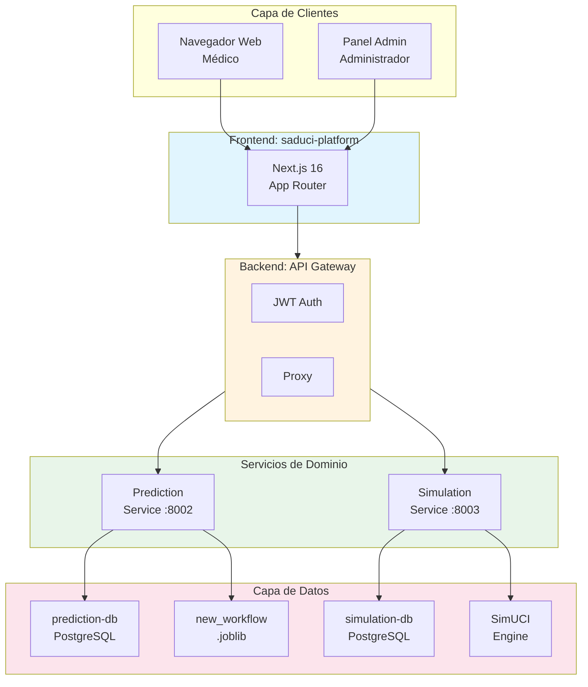
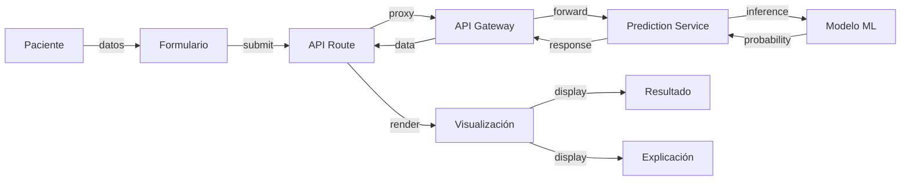
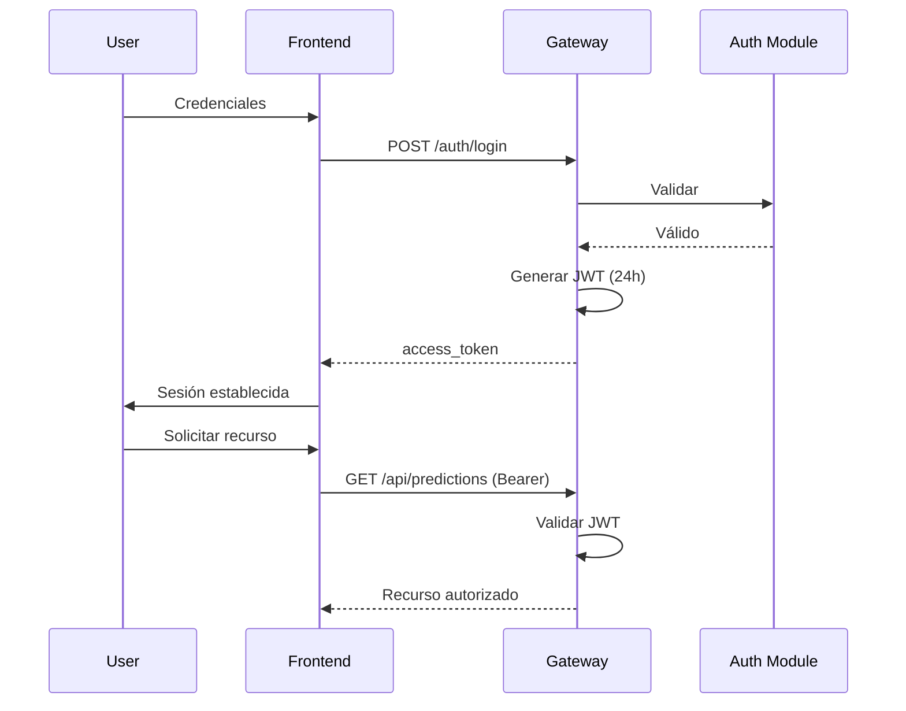
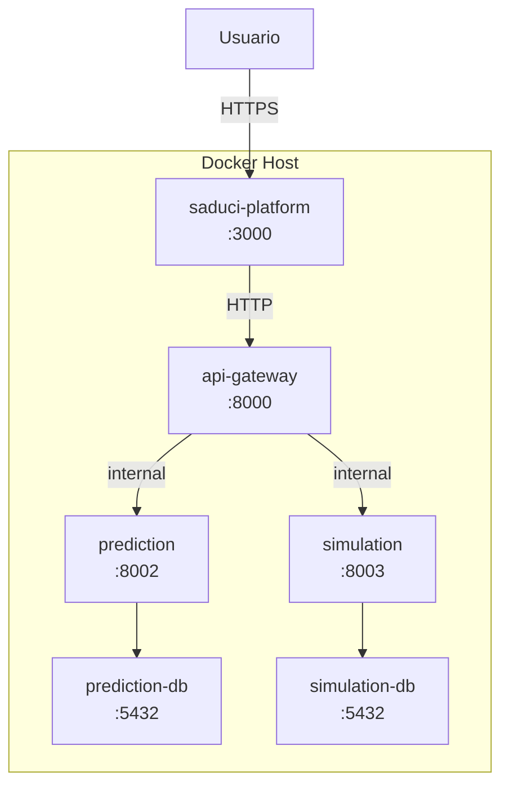

# PROMPT MAESTRO CONSOLIDADO — Capítulo 2: Ingeniería de Requisitos y Diseño (SADUCI)

> Documento único que contiene TODA la información necesaria para que un modelo de lenguaje (LLM) redacte el Capítulo 2 completo de la tesis SADUCI.

---

## INSTRUCCIONES DE USO

Este prompt debe proporcionarse completo a un LLM para generar el capítulo. El capítulo debe:
1. Estar en español
2. Seguir formato APA 7 para citas
3. Usar la estructura formal detallada en la sección 2
4. Integrar todos los diagramas Mermaid
5. Mantener consistencia terminológica (SADUCI, no SADECI)

---

## CONTEXTO DEL PROYECTO

**SADUCI** (Sistema de Apoio a Decisiones en Unidad de Cuidados Intensivos) es una plataforma web modular desenvolvida para el Hospital Universitario Arnaldo Milián Castro. La plataforma proporciona herramientas de predicción clínica y simulación basadas en modelos de inteligencia artificial para asistir al personal médico en la toma de decisiones en la UCI.

**Modelo de datos clínicos**: edad (14-100 años), diagnósticos (códigos CIE-9), score APACHE II (0-70), tiempo de ventilación mecánica, estancia en UCI.

**Modelos predictivos implementados**: mortality_risk, length_of_stay, readmission_risk.

**Motor de simulación**: SimUCI (con fallback determinista SHA-256).

**Modelo ML entrenado**: `new_workflow.joblib` (pipeline imblearn/scikit-learn).

**Explicabilidad**: SHAP, LIME, Gradientes Integrados, Mapas de Saliencia.

**Narrativa clínica**: Providers configurables (stub, local LLM, Gemini, HuggingFace).

---

## ESTRUCTURA FORMAL DEL CAPÍTULO

```
Capítulo 2: Ingeniería de Requisitos y Diseño

2.1 Introducción
  2.1.1 Contexto del proyecto
  2.1.2 Objetivos del capítulo
  2.1.3 Metodología de desarrollo

2.2 Comprensión de la Lógica del Sistema
  2.2.1 SADUCI como Medical Learning & Simulation Service (MLSS)
  2.2.2 Flujo de valor clínico
  2.2.3 Lógica de datos: sintéticos y reales

2.3 Ingeniería de Requisitos
  2.3.1 Marco metodológico (Scrum vs RUP)
  2.3.2 Actores del sistema
  2.3.3 Requisitos funcionales
  2.3.4 Requisitos no funcionales
  2.3.5 Reglas de negocio

2.4 Gestión Ágil del Proyecto
  2.4.1 Justificación del uso de Scrum
  2.4.2 Product Backlog
  2.4.3 Historias de usuario priorizadas
  2.4.4 Ejecución del Sprint 1
  2.4.5 Incremento de software resultante

2.5 Arquitectura y Diseño de Software
  2.5.1 Principios arquitectónicos
  2.5.2 Patrones de diseño (Microservicios, API Gateway, BFF, Database per Service)
  2.5.3 Diagrama de arquitectura
  2.5.4 Stack tecnológico
  2.5.5 Modelo de despliegue

2.6 Diseño de la Capa de Datos
  2.6.1 Esquema de base de datos (Database per Service)
  2.6.2 Modelos de datos (Pydantic schemas)
  2.6.3 Integridad referencial

2.7 Diseño de Interfaces de Programación
  2.7.1 Contratos de API (REST)
  2.7.2 Endpoints principales
  2.7.3 Validación de datos
```

---

## CONTENIDO DETALLADO POR SECCIÓN

### 2.2 COMPRENSIÓN DE LA LÓGICA DEL SISTEMA

**Definición MLSS**: SADUCI no es un simple visor de datos. Es un Medical Learning & Simulation Service (MLSS) que permite a los doctores crear "instancias de simulación" para predecir desenlaces (mortalidad, supervivencia) basados en modelos de IA integrados.

**Flujo de valor**:
1. Médico ingresa parámetros del paciente
2. Sistema ejecuta inferencia con modelo entrenado (new_workflow.joblib)
3. Sistema genera explicación de contribuciones por variable
4. Sistema optionally genera narrativa clínica
5. Médico recibe probabilidad + explicación + recomendación

**Lógica de datos**: El sistema procesa datos reales de pacientes (edad, diagnósticos, APACHE II) para alimentar modelos predictivos, y genera datos sintéticos mediante SimUCI para simulaciones de escenarios.

### 2.3 INGENIERÍA DE REQUISITOS

**Actores**:

| ID | Actor | Descripción | Frecuencia |
|----|-------|-------------|-----------|
| ACT-001 | Personal Médico | Consume predicciones, gestiona pacientes | Alta |
| ACT-002 | Administrador | Gestiona usuarios, configura servicios | Media |

**Requisitos Funcionales (24 total)**:

| ID | Descripción | Prioridad | Correlato |
|----|-------------|-----------|-----------|
| RF-001 | Consultar información de paciente | Alta | Prediction Service |
| RF-002 | Almacenar historial de predicciones | Alta | prediction-db |
| RF-003 | Validar rangos clínicos de datos | Crítica | Pydantic validation |
| RF-004 | Calcular riesgo de mortalidad | Crítica | POST /prediccion, new_workflow.joblib |
| RF-005 | Devolver probabilidad + clase | Crítica | PlatformPredictionResponse |
| RF-006 | Predecir estancia hospitalaria | Media | Prediction Service |
| RF-007 | Predecir riesgo de reingreso | Media | Prediction Service |
| RF-008 | Generar explicaciones por feature | Crítica | POST /prediccion/explain |
| RF-009 | Soportar métodos XAI (LIME, SHAP...) | Alta | PlatformExplanationRequest.method |
| RF-010 | Incluir valores basales | Alta | PlatformFeatureExplanationRow.baseline_value |
| RF-011 | Indicar dirección del riesgo | Alta | direction: increase/decrease/neutral |
| RF-012 | Generar narrativas clínicas (IA) | Media | Narrative providers |
| RF-013 | Ejecutar SimUCI para simulación | Alta | POST /simulations/icu |
| RF-014 | Fallback determinista SHA-256 | Alta | Simulation Service |
| RF-015 | Devolver estadísticas (mean, std, CI 95%) | Alta | TimeStats model |
| RF-016 | Configurar n_runs de replicaciones | Media | n_runs: 50-100000 |
| RF-017 | Prueba de Wilcoxon | Media | POST /statistics/wilcoxon |
| RF-018 | Prueba de Friedman | Media | POST /statistics/friedman |
| RF-019 | Devolver estadístico y p-value | Media | statistics.py schemas |
| RF-020 | Autenticación por credenciales | Crítica | POST /auth/login |
| RF-021 | Generar tokens JWT | Crítica | JWT (24h expiry) |
| RF-022 | Middleware de autorización | Crítica | Authorization: Bearer |
| RF-023 | Rutas públicas (no JWT) | Alta | /prediccion, /simulation |
| RF-024 | Distinguir roles de usuario | Alta | médico, SYSTEM ADMIN |

**Requisitos No Funcionales (16 total)**:

| Categoría | ID | Descripción | Métrica |
|-----------|-----|-------------|--------|
| Disponibilidad | RNF-001 | Disponibilidad 24/7 | 99.5% uptime |
| Disponibilidad | RNF-002 | Health checks por servicio | /health endpoint |
| Disponibilidad | RNF-003 | Reinicio automático | Docker restart: unless-stopped |
| Rendimiento | RNF-004 | Latencia de inferencia | P95 < 2000ms |
| Rendimiento | RNF-005 | Concurrencia | > 50 req/s |
| Rendimiento | RNF-006 | Carga de UI | FCP < 3s |
| Escalabilidad | RNF-007 | Escalado horizontal | Docker containers |
| Escalabilidad | RNF-008 | Separación CPU/I/O | Servicios independientes |
| Escalabilidad | RNF-009 | Database per Service | PostgreSQL por servicio |
| Seguridad | RNF-010 | Transmisión HTTPS | TLS 1.2+ |
| Seguridad | RNF-011 | Vigencia JWT | 24h máximo |
| Seguridad | RNF-012 | Aislamiento BBDD | Docker network |
| Seguridad | RNF-013 | Validación de inputs | Pydantic schemas |
| Mantenibilidad | RNF-014 | RSC por defecto | Next.js optimization |
| Mantenibilidad | RNF-015 | Cobertura de tests | > 300 componentes |
| Mantenibilidad | RNF-016 | Atomic Design | Componentes estructurados |

**Reglas de Negocio**:

| ID | Regla |
|----|-------|
| RN-001 | Edad del paciente: 14 ≤ edad ≤ 100 |
| RN-002 | APACHE II: 0 ≤ score ≤ 70 |
| RN-003 | Estancia UCI: ≤ 8760 horas (~1 año) |
| RN-004 | Ventilación mecánica ≤ estancia UCI |
| RN-005 | Probabilidad ≥ threshold (0.5) → "muere", else "vive" |
| RN-006 | Errores clínicos NO ocultados (mostrar como alertas) |

### 2.4 GESTIÓN ÁGIL

**Product Backlog**: 15 Historias de Usuario

| Prioridad | HU | Descripción |
|-----------|----|-------------|
| Must | HU-001 | Visualizar riesgo de mortalidad |
| Must | HU-002 | Ver explicaciones de predicciones |
| Must | HU-003 | Autenticarse de forma segura |
| Must | HU-004 | Ejecutar simulaciones clínicas |
| Must | HU-005 | Gestionar usuarios del sistema |
| Should | HU-006 | Generar narrativas clínicas automáticas |
| Should | HU-007 | Consultar pruebas estadísticas |
| Should | HU-008 | Visualizar gráficos de estadísticas |
| Could | HU-009 | Predecir estancia hospitalaria |
| Could | HU-010 | Predecir riesgo de reingreso |
| Could | HU-011 | Monitorear estado de servicios |
| Could | HU-012 | Gestionar pacientes centralizadamente |
| Won't Have | HU-013 | Integración con sistemas HIS |
| Won't Have | HU-014 | Alertas proactivas de anomalías |
| Won't Have | HU-015 | Colaboración en tiempo real |

**Sprint 1 MVP**: 4 semanas, 57 días-persona estimados

- SP1-001: Configurar Docker Compose ✓
- SP1-002: Implementar API Gateway JWT ✓
- SP1-003: Prediction Service con modelo mortality_risk ✓
- SP1-004: Simulation Service con SimUCI ✓
- SP1-005: Endpoints XAI (SHAP/LIME) ✓
- SP1-006: Frontend Next.js 16 ✓
- SP1-007: Sistema de autenticación ✓
- SP1-008: Integración de endpoints ✓
- SP1-009: Testing (324 tests passing) ✓

### 2.5 ARQUITECTURA

**Stack Tecnológico**:

**Frontend** (saduci-platform):
- Next.js 16.1.6 + React 19.2.3
- Bun 1.3+ (runtime y test runner)
- Tailwind CSS v4
- Recharts (gráficos)
- @tanstack/react-table
- Happy DOM + Bun test (324 tests)

**Backend** (saduci-core):
- FastAPI (Python) para API Gateway
- scikit-learn 1.6.1 + imbalanced-learn (ML)
- joblib (serialización de modelos)
- SimUCI (motor de simulación, opcional)
- PostgreSQL (Database per Service)

**Infraestructura**:
- Docker + Docker Compose
- Health checks por servicio
- Restart policy: unless-stopped

**Servicios**:
| Servicio | Puerto | Base de Datos | Carga |
|----------|--------|---------------|-------|
| API Gateway | 8000 | — | I/O |
| Prediction Service | 8002 | prediction-db | CPU |
| Simulation Service | 8003 | simulation-db | CPU |

**Patrones Arquitectónicos**:
1. **Microservicios**: Separación CPU-bound (ML) de I/O-bound (web)
2. **API Gateway**: Autenticación JWT + proxy centralizado
3. **BFF**: Frontend Next.js adapta contratos API
4. **Database per Service**: PostgreSQL independiente por dominio

**Decisiones Arquitectónicas**:

| ID | Decisión | Justificación |
|----|----------|---------------|
| ARQ-001 | Microservicios | Escalabilidad independiente CPU/I/O |
| ARQ-002 | JWT | Stateless, escalable, multi-cliente |
| ARQ-003 | Database per Service | Desacoplamiento y autonomía |
| ARQ-004 | RSC por defecto | Optimización de render, menos JS al cliente |
| ARQ-005 | Atomic Design | Consistencia, reutilización, testabilidad |
| ARQ-006 | SimUCI + fallback | Disponibilidad sin dependencia externa |
| ARQ-007 | Docker Compose | Despliegue reproducible |
| ARQ-008 | BFF pattern | Adaptación de contratos API a React |

### 2.6 MODELO DE DATOS

**prediction-db** (PostgreSQL):

Tabla `predictions`:
- id (UUID, PK), patient_id, model_name, features (JSONB)
- probability (float), predicted_class (int), predicted_label (varchar)
- threshold, created_at

Tabla `prediction_explanations`:
- id (UUID, PK), prediction_id (FK), method
- feature_names, importances, rows (JSONB)
- narrative, narrative_provider, narrative_model

Tabla `users`:
- id (PK), email, username, hashed_password
- is_active, is_superuser, created_at, updated_at

**simulation-db** (PostgreSQL):

Tabla `simulations`:
- id (UUID, PK), patient_id, scenario, parameters (JSONB)
- results (JSONB), mortality_rate, survival_probability, created_at

Tabla `simulation_statistics`:
- id (UUID, PK), simulation_id (FK)
- mean, std, ci_lower, ci_upper, created_at

Tabla `statistical_tests`:
- id (UUID, PK), test_name, samples (JSONB)
- statistic, p_value, interpretation, created_at

**Pydantic Schemas** (validación de API):

- `PlatformPredictionRequest`: edad (14-61), diag_ing1 (1-20), diag_ing2 (39-173), diag_egr2 (18-40), apache (18-40), tiempo_vam (18-40)
- `PlatformPredictionResponse`: probability, probability_percent, predicted_class, predicted_label ("vive"/"muere"), threshold
- `PlatformExplanationRequest`: method (LIME/SHAP/etc), include_narrative, ai_provider, temperature
- `PlatformExplanationResponse`: method, rows[], narrative, narrative_provider
- `ICUPatientSimulationRequest`: patient_id, age (14-100), apache (0-70), diagnosis codes, uti_stay (1-8760h), vam_time (0-8760h), n_replications (1-1000)
- `TimeStats`: mean, std, ci_lower, ci_upper (95%)

### 2.7 CONTRATOS DE API

**Base URL**: `http://localhost:8000` (desarrollo)

| Método | Ruta | Auth | Descripción |
|--------|------|------|-------------|
| POST | /auth/login | No | Login, retorna JWT |
| POST | /prediccion | No* | Predicción de mortalidad |
| POST | /prediccion/explain | No* | Predicción con XAI |
| POST | /simulations/icu | No* | Simulación UCI |
| GET | /simulations/{id} | JWT | Historial simulaciones |
| GET | /scenarios | No | Listar escenarios |
| POST | /statistics/wilcoxon | No* | Prueba Wilcoxon |
| POST | /statistics/friedman | No* | Prueba Friedman |
| POST | /users | JWT (Admin) | Crear usuario |
| GET | /health | No | Health check |

*\* Rutas públicas para saduci-platform (CORS configurado)*

**Ejemplo POST /prediccion**:
```json
Request: { "edad": 65, "apache": 25, "diag_ing1": 5, ... }
Response: {
  "probability": 0.73,
  "probability_percent": 73.0,
  "predicted_class": 1,
  "predicted_label": "muere",
  "threshold": 0.5
}
```

---

## CITAS OBLIGATORIAS

**Citas en texto (APA 7)**:

1. Shortliffe & Cimino (2014): Base de CDSS
2. Sutton et al. (2020): Taxonomía funcional de CDSS
3. IEEE 830-1998: Estándar de especificación de requisitos
4. Schwaber & Sutherland (2020): Scrum Guide

**Formato de referencias**:
```
Shortliffe, E. H., & Cimino, J. J. (2014). Biomedical informatics:
Computer applications in health care and biomedicine (4th ed.). Springer.

Sutton, R. T., et al. (2020). An overview of clinical decision support
systems: Benefits, risks, and strategies for success. NPJ Digital
Medicine, 3(1), 1-10. https://doi.org/10.1038/s41746-020-0221-5

Institute of Electrical and Electronics Engineers. (1998). IEEE
recommended practice for software requirements specifications
(IEEE Std 830-1998). IEEE.

Schwaber, K., & Sutherland, J. (2020). The Scrum Guide. Scrum.org.
https://www.scrumguides.org/
```

---

## DIAGRAMAS MERMAID A INTEGRAR

### Diagrama de arquitectura de alto nivel


### Diagrama de flujo de predicción


### Diagrama de secuencia de autenticación


### Diagrama de modelo de despliegue


---

## FORMATO DE ENTREGA

El capítulo debe entregarse como documento markdown completo con:
1. Encabezados H1 (#), H2 (##), H3 (###), H4 (####)
2. Párrafos académicos con citas APA 7 integradas
3. Tablas formateadas con bordes claros
4. Diagramas Mermaid embebidos
5. Listados cuando sea apropiado
6. Referencias cruzadas entre secciones
7. Sección de referencias bibliográficas al final

**Extensión estimada**: 8,000 - 12,000 palabras

**Verificación final antes de entregar**:
- [ ] Nombre "SADUCI" consistente
- [ ] Citas APA 7 correctas
- [ ] Diagramas Mermaid compilan
- [ ] Cada requisito con correlato arquitectónico
- [ ] No hay referencias a archivos internos del repositorio
- [ ] Vocabulario técnico consistente
