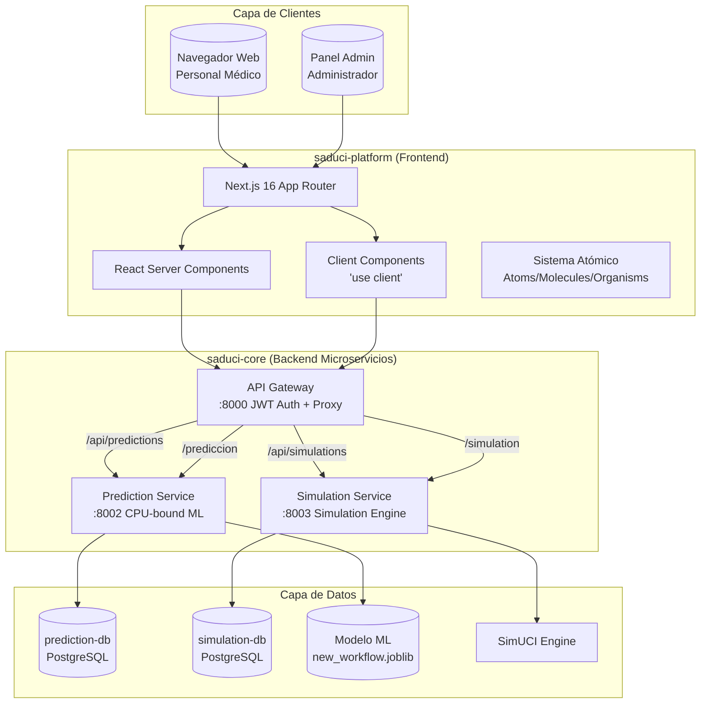
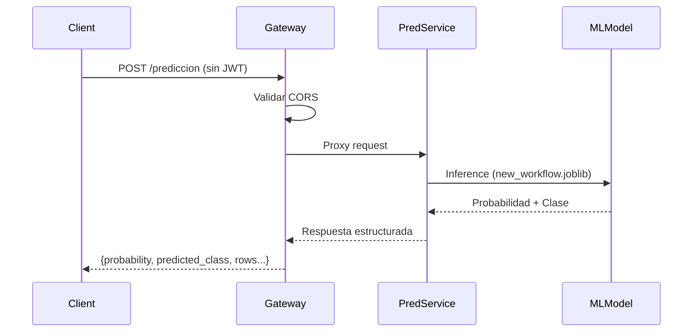
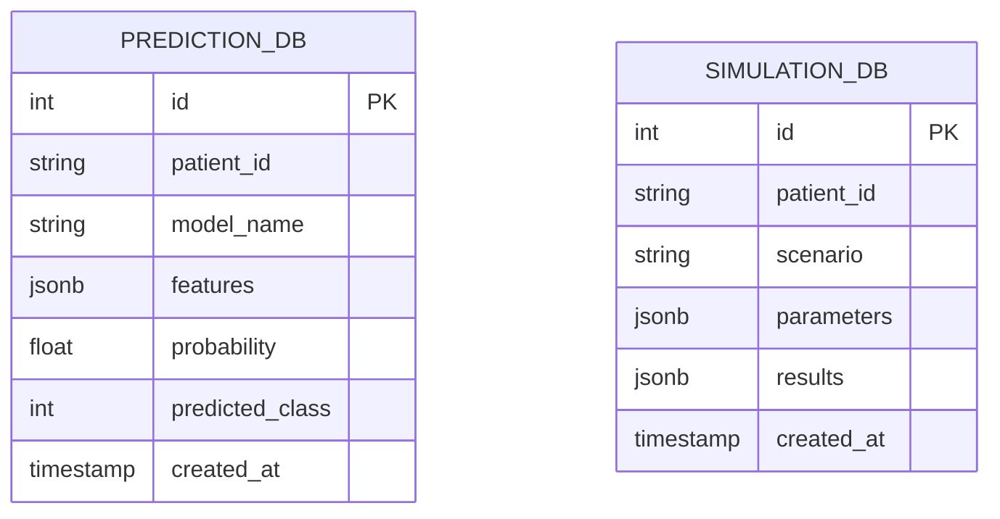
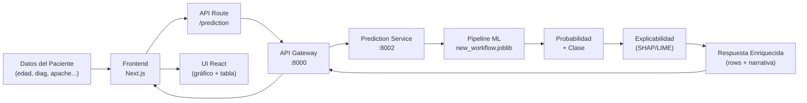
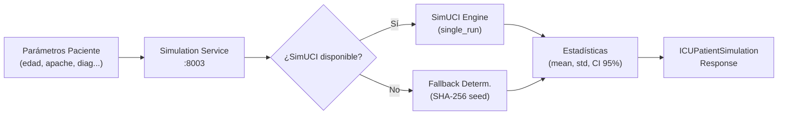
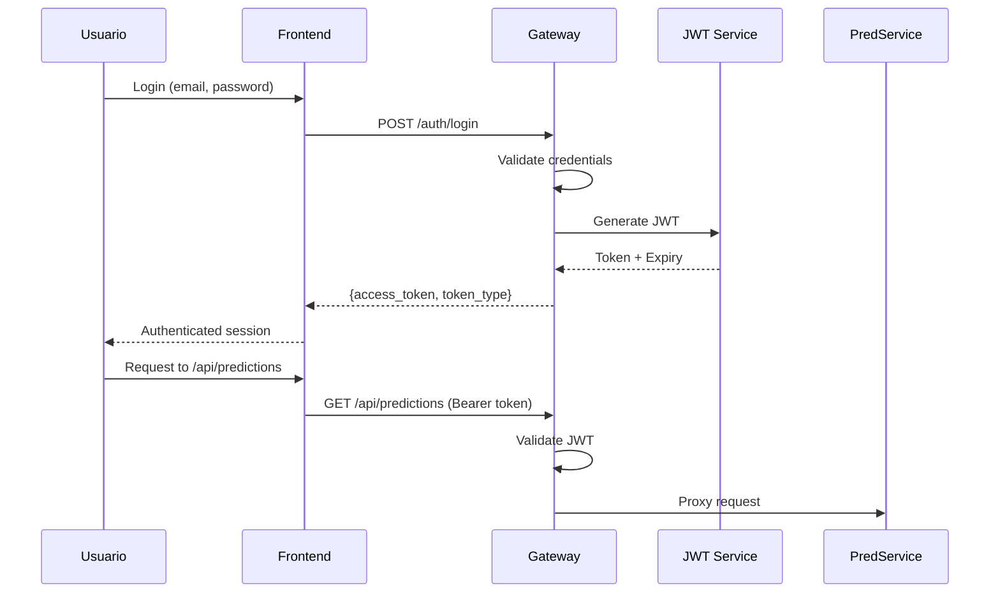
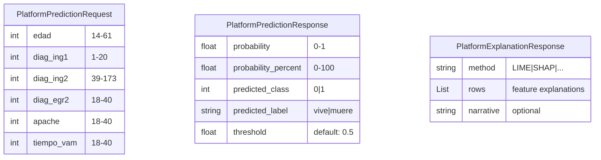
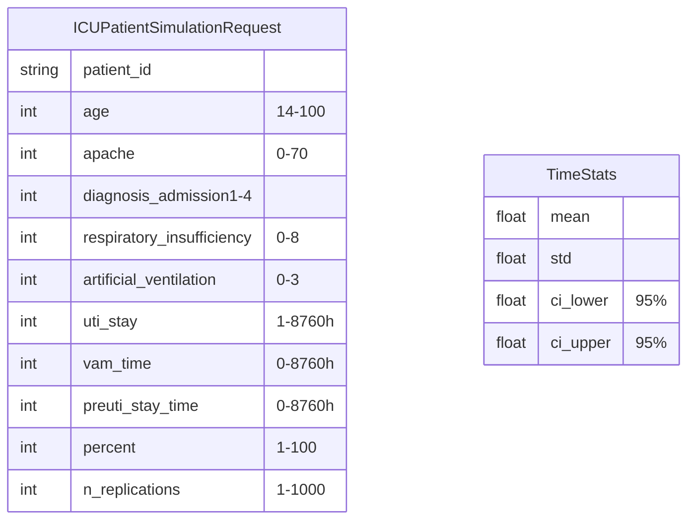

# Arquitectura de SADUCI

## 1. Visión General de la Arquitectura

SADUCI implementa una **arquitectura de microservicios** diseñada para separar cargas de trabajo diferenciadas: los servicios de inferencia de modelos (CPU-bound) se ejecutan independientemente de la lógica web de entrada/salida (I/O-bound). Esta modularidad permite escalar cada componente según la demanda y facilita el mantenimiento independizado.

La plataforma se compone de dos repositorios principales:
- **saduci-core**: Backend Python/FastAPI con microservicios
- **saduci-platform**: Frontend Next.js 16 + React 19

---

## 2. Diagrama de Arquitectura de Alto Nivel



---

## 3. Patrones Arquitectónicos

### 3.1 Microservicios

Cada servicio de dominio es independiente y autocontenido:

| Servicio | Responsabilidad | Puerto | Base de Datos | Carga |
|----------|-----------------|--------|---------------|-------|
| API Gateway | Autenticación JWT y proxy | 8000 | — | I/O |
| Prediction Service | Inferencia ML y explicabilidad | 8002 | prediction-db | CPU |
| Simulation Service | Simulación clínica y estadística | 8003 | simulation-db | CPU |

### 3.2 API Gateway Pattern

El API Gateway centraliza todas las peticiones HTTP, proporcionando:

- **Autenticación JWT**: Validación de tokens para rutas protegidas
- **Proxy inverso**: Redirección a servicios internos según la ruta
- **Rutas públicas**: Endpoints específicos sin JWT para la plataforma web
- **Rutas protegidas**: Endpoints internos que requieren Bearer token



### 3.3 Database per Service

Cada microservicio mantiene su propia base de datos PostgreSQL:



### 3.4 BFF (Backend for Frontend)

El frontend Next.js actúa como BFF, consumiendo los microservicios mediante API routes internas que adaptan los contratos al formato esperado por los componentes React.

---

## 4. Stack Tecnológico

### 4.1 Frontend (saduci-platform)

| Componente | Tecnología | Versión | Propósito |
|------------|------------|---------|-----------|
| Framework | Next.js | 16.1.6 | App Router + RSC |
| UI Library | React | 19.2.3 | Concurrent Features |
| Runtime | Bun | 1.3+ | Bundler, test runner |
| Styling | Tailwind CSS | v4 | Utility-first CSS |
| Charts | Recharts | — | Visualización de datos |
| Icons | react-icons | — | SVG vectoriales |
| Table | @tanstack/react-table | — | Tablas headless |
| Testing | Bun test + Happy DOM | — | Unit tests |

### 4.2 Backend (saduci-core)

| Componente | Tecnología | Propósito |
|------------|-----------|---------|
| API Gateway | FastAPI (Python) | Autenticación y proxy |
| ML Services | Python (scikit-learn) | Inferencia de modelos |
| Simulation | Python + SimUCI | Motor de simulación |
| Serialization | joblib | Modelos entrenados |
| Orchestration | Docker Compose | Contenedores |
| Database | PostgreSQL | Persistencia por servicio |

### 4.3 Infraestructura

| Componente | Tecnología | Propósito |
|------------|-----------|----------|
| Containers | Docker + Docker Compose | Despliegue modular |
| Health Checks | HTTP /health | Monitoreo de servicios |
| Network | Docker internal | Aislamiento de BBDD |
| Restart Policy | unless-stopped | Recuperación automática |

---

## 5. Flujo de Datos

### 5.1 Flujo de Predicción Clínica



### 5.2 Flujo de Simulación Clínica



### 5.3 Flujo de Autenticación



---

## 6. Modelo de Despliegue

```mermaid
graph TD
    subgraph DockerHost["Host (Docker Compose)"]
        Gateway[("api-gateway\n:8000")]
        Pred[("prediction\n:8002")]
        PredDB[("prediction-db\nPostgreSQL")]
        Sim[("simulation\n:8003")]
        SimDB[("simulation-db\nPostgreSQL"))

        Gateway --> Pred
        Gateway --> Sim
        Pred --> PredDB
        Sim --> SimDB
    end

    subgraph External["Acceso Externo"]
        Browser["Navegador\n:saduci-platform"]
        Platform["saduci-platform\n:3000"]
    end

    Platform -->|"HTTP"| Gateway
    Browser -->|"HTTPS"| Platform
```

---

## 7. Modelos de Datos

### 7.1 Esquemas de Predicción



### 7.2 Esquemas de Simulación



---

## 8. Decisiones Arquitectónicas

| ID | Decisión | Justificación |
|----|----------|---------------|
| ARQ-001 | Microservicios sobre monolito | Separación de cargas CPU/I/O, escalabilidad independiente |
| ARQ-002 | JWT para autenticación | Stateless, escalable, compatible con múltiples clientes |
| ARQ-003 | Database per Service | Desacoplamiento, autonomía de cada dominio |
| ARQ-004 | RSC por defecto en Next.js | Optimización de render inicial, reducción de JavaScript al cliente |
| ARQ-005 | Atomic Design para componentes | Consistencia visual, reutilización, testabilidad |
| ARQ-006 | SimUCI con fallback determinista | Disponibilidad garantizada sin dependencia de biblioteca externa |
| ARQ-007 | Docker Compose con health checks | Despliegue reproducible y monitoreo de disponibilidad |
| ARQ-008 | BFF pattern en Next.js | Adaptación de contratos API al formato React |
