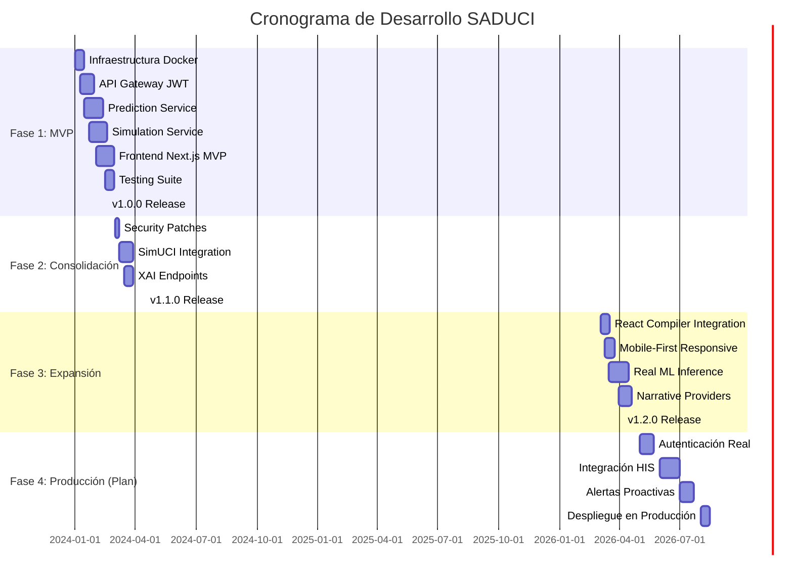
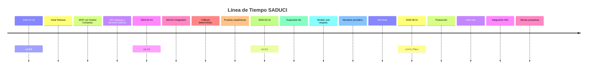
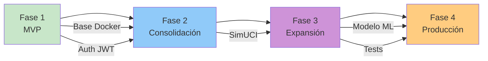

# Cronograma de Desarrollo SADUCI

> Basado en los milestones documentados en CHANGELOG.md

---

## 1. Línea de Tiempo General

---

## 2. Entregables por Fase

### Fase 1: MVP (v1.0.0)
**Fecha objetivo:** 2024-01-15 → 2024-02-19

| Entregable | Descripción | Estado |
|------------|-------------|--------|
| D1.1 | Docker Compose con 5 servicios | ✓ |
| D1.2 | API Gateway con JWT | ✓ |
| D1.3 | Prediction Service (dummy model) | ✓ |
| D1.4 | Simulation Service | ✓ |
| D1.5 | Frontend básico | ✓ |
| D1.6 | Suite de tests (137 tests) | ✓ |

### Fase 2: Consolidación (v1.1.0)
**Fecha objetivo:** 2024-03-01 → 2024-04-15

| Entregable | Descripción | Estado |
|------------|-------------|--------|
| D2.1 | SimUCI integration | ✓ |
| D2.2 | Centroid data (centroids.csv) | ✓ |
| D2.3 | Fallback determinista (SHA-256) | ✓ |
| D2.4 | Pruebas estadísticas (Wilcoxon/Friedman) | ✓ |

### Fase 3: Expansión (v1.2.0)
**Fecha objetivo:** 2026-03-03 → 2026-04-05

| Entregable | Descripción | Estado |
|------------|-------------|--------|
| D3.1 | React 19 + Next.js 16 | ✓ |
| D3.2 | Real ML inference (new_workflow.joblib) | ✓ |
| D3.3 | Narrative providers (stub, gemini, local, huggingface) | ✓ |
| D3.4 | Mobile-first responsive design | ✓ |
| D3.5 | 324 tests passing | ✓ |
| D3.6 | Atomic Design components | ✓ |

### Fase 4: Producción (Plan)
**Fecha objetivo:** 2026-05-01 → 2026-08-01

| Entregable | Descripción | Prioridad |
|------------|-------------|-----------|
| D4.1 | Autenticación real (no demo) | Crítica |
| D4.2 | Integración con sistemas HIS del hospital | Alta |
| D4.3 | Alertas proactivas de anomalías | Media |
| D4.4 | Despliegue en infraestructura de producción | Crítica |

---

## 3. Milestones

---

## 4. Riesgos del Cronograma

| ID | Riesgo | Probabilidad | Impacto | Mitigación |
|----|--------|--------------|---------|-----------|
| R1 | Dependencia de SimUCI library | Media | Alto | Fallback determinista implementado |
| R2 | Retraso en integración HIS | Alta | Alto | Priorizar v2.0.0 con API REST |
| R3 | Disponibilidad de infraestructura | Media | Medio | Docker Compose portable |
| R4 | Cambios en requisitos del hospital | Media | Medio | Scrum adaptativo, sprints cortos |

---

## 5. Recursos Asignados

| Rol | Responsabilidad | Fase |
|----|----------------|------|
| Backend Developer | Microservicios Python/FastAPI | F1, F2, F3 |
| Frontend Developer | Next.js/React | F1, F3 |
| ML Engineer | Modelos, XAI, SimUCI | F2, F3 |
| DevOps | Docker, CI/CD, infraestructura | F1, F4 |
| Clinical Advisor | Validación clínica de predicciones | F2, F4 |

---

## 6. Dependencias Entre Fases

