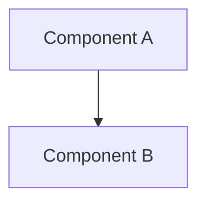

# Guía de Escritura — Capítulo 2: Ingeniería de Requisitos y Diseño

> Este documento sirve como referencia para que un agente IA escriba el Capítulo 2 de la tesis SADUCI de forma autónoma, siguiendo las convenciones académicas y el contenido de los archivos de soporte.

---

## 1. Estructura Formal del Capítulo

```
Capítulo 2: Ingeniería de Requisitos y Diseño
├── 2.1 Introducción
│   └── 2.1.1 Contexto del proyecto
│   └── 2.1.2 Objetivos del capítulo
│   └── 2.1.3 Metodología de desarrollo
│
├── 2.2 Comprensión de la Lógica del Sistema
│   └── 2.2.1 SADUCI como Medical Learning & Simulation Service
│   └── 2.2.2 Flujo de valor clínico
│   └── 2.2.3 Lógica de datos: sintéticos y reales
│
├── 2.3 Ingeniería de Requisitos
│   └── 2.3.1 Marco metodológico
│   └── 2.3.2 Actores del sistema
│   └── 2.3.3 Requisitos funcionales
│   └── 2.3.4 Requisitos no funcionales
│   └── 2.3.5 Reglas de negocio
│
├── 2.4 Gestión Ágil del Proyecto
│   └── 2.4.1 Justificación del uso de Scrum
│   └── 2.4.2 Product Backlog
│   └── 2.4.3 Historias de usuario priorizadas
│   └── 2.4.4 Ejecución del Sprint 1
│   └── 2.4.5 Incremento de software resultante
│
├── 2.5 Arquitectura y Diseño de Software
│   └── 2.5.1 Principios arquitectónicos
│   └── 2.5.2 Patrones de diseño
│   └── 2.5.3 Diagrama de arquitectura
│   └── 2.5.4 Stack tecnológico
│   └── 2.5.5 Modelo de despliegue
│
├── 2.6 Diseño de la Capa de Datos
│   └── 2.6.1 Esquema de base de datos
│   └── 2.6.2 Modelos de datos
│   └── 2.6.3 Integridad referencial
│
└── 2.7 Diseño de Interfaces de Programación
    └── 2.7.1 Contratos de API
    └── 2.7.2 Endpoints principales
    └── 2.7.3 Validación de datos
```

---

## 2. Guía de Citas (APA 7)

### 2.1 Citas en el texto

**Cita directa (menos de 40 palabras):**
> "Los sistemas de apoyo a la decisión clínica son sistemas de información que asisten a los profesionales de la salud en la toma de decisiones" (Shortliffe & Cimino, 2014).

**Cita indirecta (paráfrasis):**
> Según Shortliffe y Cimino (2014), los CDSS integrando conocimiento médico con datos del paciente pueden mejorar significativamente los desenlaces clínicos.

**Citación de múltiples autores:**
> (Sutton et al., 2020)

### 2.2 Referencias en la sección de referencias

```
Shortliffe, E. H., & Cimino, J. J. (2014). Biomedical informatics: Computer
applications in health care and biomedicine (4th ed.). Springer.

Sutton, R. T., Pincock, D., Baumgart, D. C., Sadowski, D. C., Fedorak, R. N.,
& Kroeker, K. I. (2020). An overview of clinical decision support systems:
Benefits, risks, and strategies for success. NPJ Digital Medicine, 3(1), 1-10.
https://doi.org/10.1038/s41746-020-0221-5
```

### 2.3 Citas de estándares técnicos

```
Institute of Electrical and Electronics Engineers. (1998). IEEE recommended
practice for software requirements specifications (IEEE Std 830-1998).
IEEE.
```

```
Schwaber, K., & Sutherland, J. (2020). The Scrum Guide. Scrum.org.
https://www.scrumguides.org/
```

---

## 3. Convenciones de Escritura

### 3.1 Nomenclatura oficial

| Término | Uso correcto | Evitar |
|---------|-------------|--------|
| Nombre de la plataforma | **SADUCI** | SADECI, Saduci, SADUCI platform |
| Unidad de Cuidados Intensivos | **UCI** | UTI (se reserva para Urinary Tract Infection) |
| Servicio | **Prediction Service** | prediction service, prediction microservice |
| Frontend | **saduci-platform** | frontend, platform, frontend-saduci |
| Backend | **saduci-core** | core, backend, backend-saduci |

### 3.2 Formato de requisitos

Cada requisito debe seguir el formato:
```
[ID]: [Descripción del requisito]
→ Correlato arquitectónico: [Servicio/Componente]
→ Endpoint: [Ruta de API si aplica]
→ Validación: [Regla de validación si aplica]
```

Ejemplo:
```
RF-004: El sistema debe calcular el riesgo de mortalidad de un paciente
        utilizando el modelo entrenado new_workflow.joblib
→ Correlato arquitectónico: Prediction Service (saduci-core/services/prediction)
→ Endpoint: POST /prediccion
→ Validación: PlatformPredictionRequest (Pydantic)
```

### 3.3 Formato de tablas de requisitos

Usar formato con bordes claros:
```
| ID    | Requisito                          | Prioridad | Estado |
|-------|------------------------------------|-----------|--------|
| RF-001| Visualizar riesgo de mortalidad    | Crítica   | ✓      |
| RF-002| Ver explicaciones de predicción   | Alta      | ✓      |
```

### 3.4 Formato de diagramas

Insertar diagramas Mermaid directamente en el texto Markdown:

````markdown

````

---

## 4. Plantillas de Párrafo por Sección

### 4.1 Introducción de sección

> La presente sección describe [tema]. Para ello, se adoptó [metodología/enfoque], considerando [contexto o justificación breve].

### 4.2 Descripción de requisito

> El requisito funcional **RF-[N]** establece que [descripción formal del requisito]. Este requisito responde a la necesidad de [contexto clínico o de negocio] identificada durante [etapa de elicitación]. Desde el punto de vista arquitectónico, este requisito es atendido por [componente/microservicio], específicamente a través del endpoint [ruta].

### 4.3 Justificación de decisión arquitectónica

> La decisión de adoptar [patrón/tecnología/decisión] se fundamenta en [razón 1]. Adicionalmente, [razón 2]. Esta decisión es consistente con lo reportado por [autor/cita], quienes señalan que [argumento de la literatura].

### 4.4 Conclusión de sección

> En resumen, esta sección ha establecido [resumen de lo cubierto]. Los requisitos funcionales identificados ([número]) y no funcionales ([número]) proporcionan la base para el desarrollo de [nombre del increment], cuyo diseño arquitectónico se detalla en la sección siguiente.

---

## 5. Mapeo de Archivos de Soporte a Secciones

| Sección del Capítulo | Archivo de Soporte | Contenido Específico |
|---------------------|--------------------|--------------------|
| 2.2 MLSS | `00_MASTER_PROMPT.md` | Definición MLSS, flujo de valor |
| 2.3.1 Metodología | `00_MASTER_PROMPT.md` | Justificación Scrum vs RUP |
| 2.3.2 Actores | `01_requisitos.md` §2 | ACT-001, ACT-002 |
| 2.3.3 RF | `01_requisitos.md` §3 | Tabla RF-001 a RF-024 |
| 2.3.4 RNF | `01_requisitos.md` §4 | Tabla RNF-001 a RNF-016 |
| 2.3.5 Reglas negocio | `01_requisitos.md` §5 | RN-001 a RN-006 |
| 2.4.2 Product Backlog | `02_backlog.md` §1 | HU-001 a HU-015 |
| 2.4.3 Historias usuario | `02_backlog.md` §1 | Tabla MoSCoW |
| 2.4.4 Sprint 1 | `03_sprints.md` | Ejecución por semanas |
| 2.5.1 Principios | `04_arquitectura.md` §3 | Patrones arquitectónicos |
| 2.5.2 Patrones | `04_arquitectura.md` §3 | Tabla de patrones |
| 2.5.3 Diagrama | `04_arquitectura.md` §2 | Mermaid de alto nivel |
| 2.5.4 Stack | `04_arquitectura.md` §4 | Tabla de tecnologías |
| 2.6 Modelo datos | `05_modelo_datos.md` | ER diagrams, tablas |
| 2.7 Contratos API | `06_api_contratos.md` | Endpoints con ejemplos |

---

## 6. Palabras Clave y Frases Obligatorias

| Categoría | Términos a usar |
|-----------|-----------------|
| Sistema | SADUCI, plataforma, MLSS, CDSS |
| Arquitectura | microservicios, API Gateway, BFF, Database per Service |
| ML/IA | inferencia, explicabilidad, XAI, SHAP, LIME, modelo predictivo |
| Scrum | Product Backlog, Sprint Backlog, Incremento, Historia de Usuario |
| Datos | paciente, UCI, APACHE II, SimUCI, predicción de mortalidad |
| Web | Next.js, React Server Components, Atomic Design, RSC |

---

## 7. Verificación de Consistencia

Antes de entregar el capítulo redactado, verificar:

- [ ] Todos los IDs de requisitos (RF-XXX, RNF-XXX) son únicos y secuenciales
- [ ] Todas las referencias cruzadas son correctas (figuras referenciadas existen)
- [ ] El nombre "SADUCI" es consistente en todo el texto
- [ ] Las citas siguen formato APA 7
- [ ] Los diagramas Mermaid compilan correctamente
- [ ] No hay referencias a archivos internos (solo a secciones del capítulo)
- [ ] Cada requisito tiene correlato arquitectónico identificado
- [ ] El vocabulario técnico es consistente (API Gateway, no "gateway de API")
