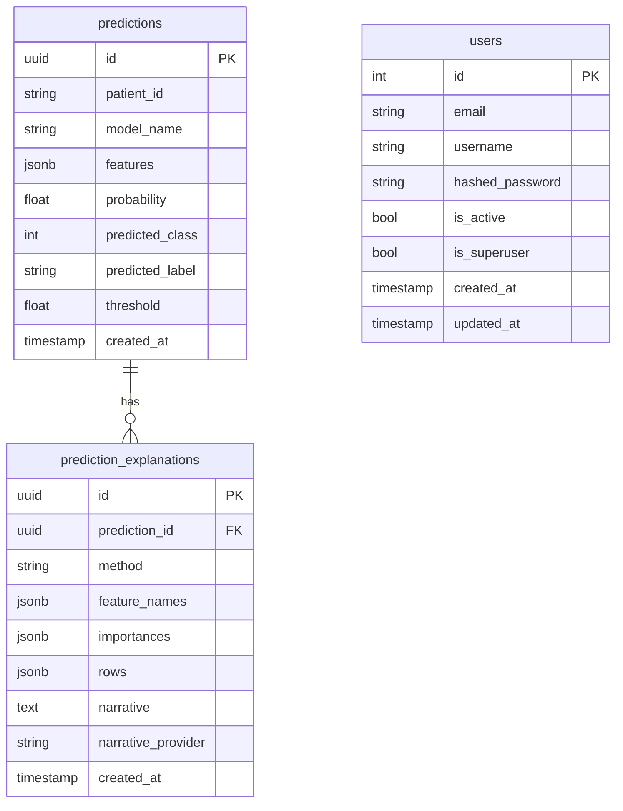
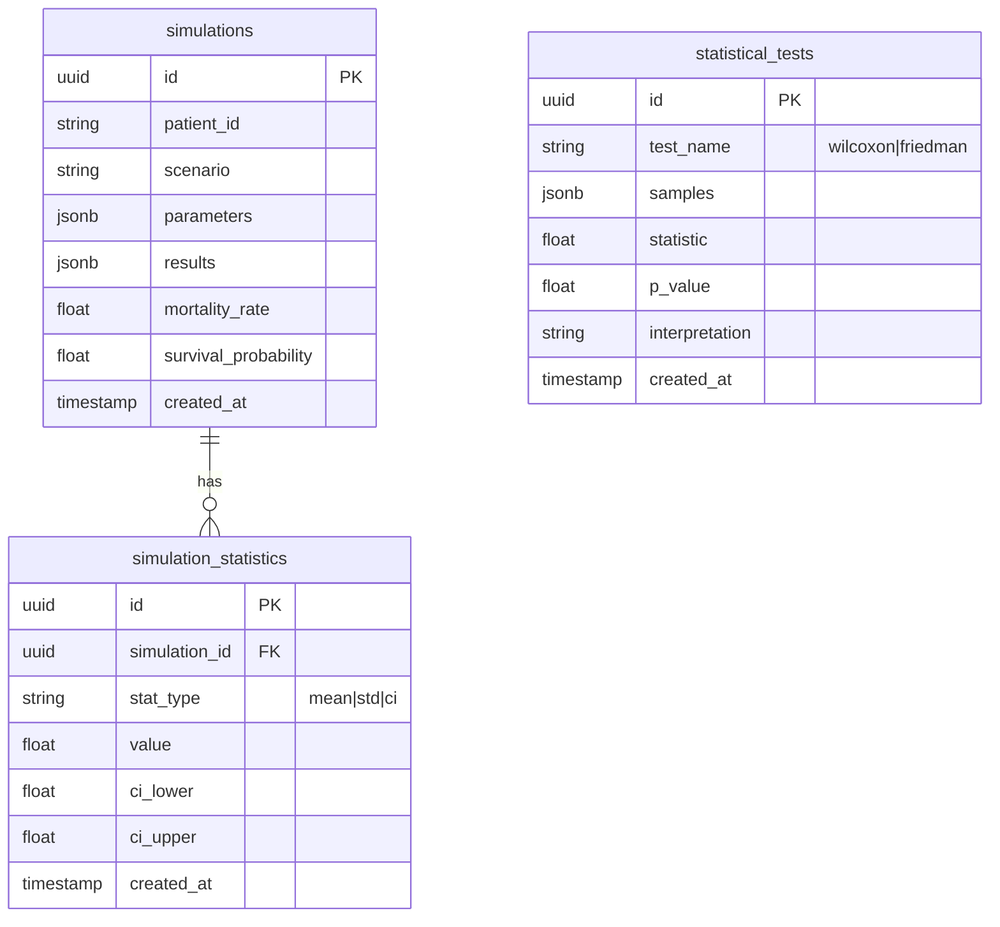
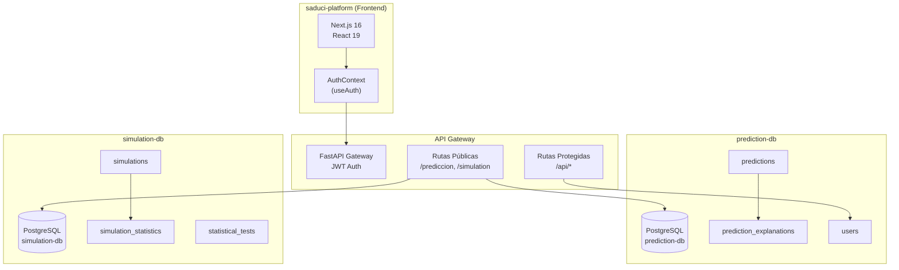
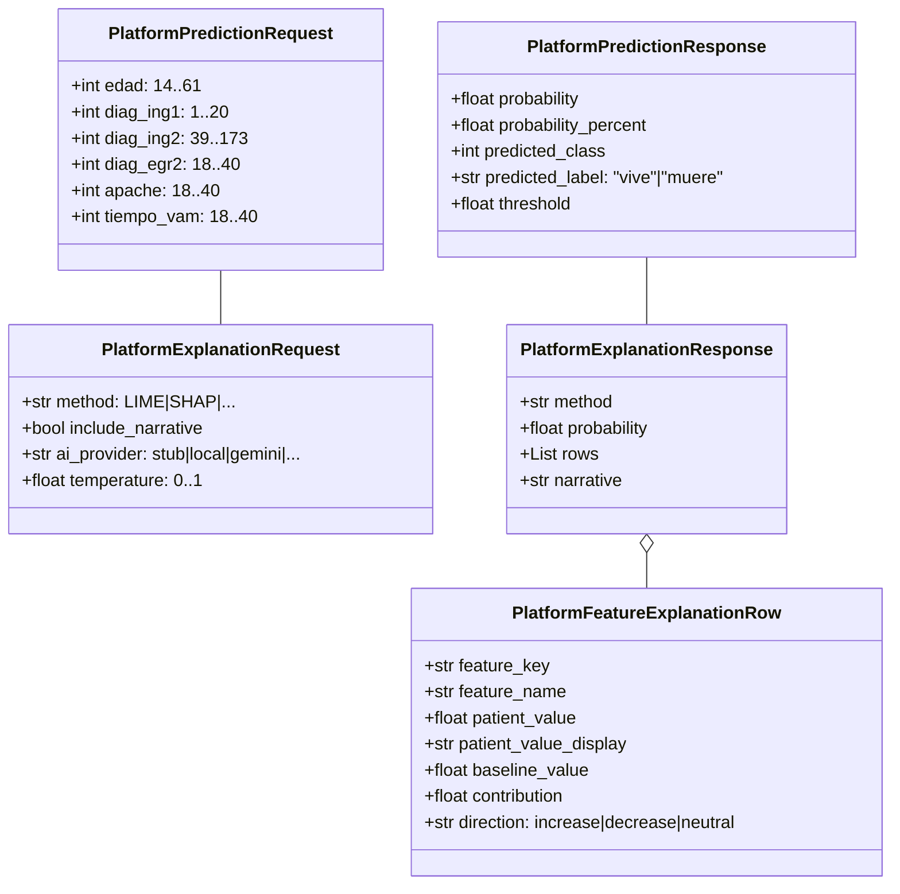
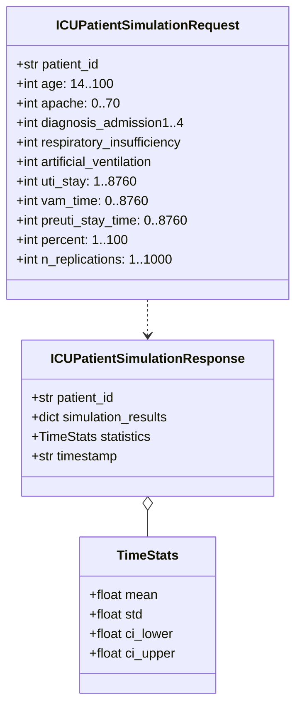

# Modelo de Datos SADUCI

## 1. Visión General

El modelo de datos de SADUCI sigue el patrón **Database per Service**, donde cada microservicio mantiene su propia base de datos PostgreSQL. Esto garantiza el desacoplamiento entre dominios y evita puntos únicos de fallo.

---

## 2. Esquema de Datos

### 2.1 prediction-db (Base de Datos del Prediction Service)

### 2.2 simulation-db (Base de Datos del Simulation Service)

---

## 3. Tablas Detalladas

### 3.1 Tabla: `predictions`

| Columna | Tipo | Constraints | Descripción |
|---------|------|-------------|-------------|
| `id` | UUID | PK, DEFAULT gen_random_uuid() | Identificador único |
| `patient_id` | VARCHAR(100) | NOT NULL | ID del paciente |
| `model_name` | VARCHAR(50) | NOT NULL | Nombre del modelo usado |
| `features` | JSONB | NOT NULL | Features de entrada |
| `probability` | FLOAT | NOT NULL | Probabilidad calculada (0-1) |
| `predicted_class` | INTEGER | NOT NULL | Clase predicha (0: sobrevive, 1: no sobrevive) |
| `predicted_label` | VARCHAR(10) | NOT NULL | Etiqueta legible ("vive", "muere") |
| `threshold` | FLOAT | NOT NULL DEFAULT 0.5 | Umbral de decisión |
| `created_at` | TIMESTAMP | DEFAULT NOW() | Fecha de creación |

**Índices:**
- `idx_predictions_patient_id` ON (`patient_id`)
- `idx_predictions_created_at` ON (`created_at`)

### 3.2 Tabla: `prediction_explanations`

| Columna | Tipo | Constraints | Descripción |
|---------|------|-------------|-------------|
| `id` | UUID | PK, DEFAULT gen_random_uuid() | Identificador único |
| `prediction_id` | UUID | FK → `predictions.id` | Predicción asociada |
| `method` | VARCHAR(50) | NOT NULL | Método XAI utilizado |
| `feature_names` | JSONB | NOT NULL | Nombres de features |
| `importances` | JSONB | NOT NULL | Importancias relativas |
| `rows` | JSONB | NOT NULL | Datos detallados por feature |
| `narrative` | TEXT | NULLABLE | Texto narrativo generado |
| `narrative_provider` | VARCHAR(20) | NULLABLE | Proveedor de IA |
| `narrative_model` | VARCHAR(50) | NULLABLE | Modelo utilizado |
| `created_at` | TIMESTAMP | DEFAULT NOW() | Fecha de creación |

### 3.3 Tabla: `users`

| Columna | Tipo | Constraints | Descripción |
|---------|------|-------------|-------------|
| `id` | SERIAL | PK | Identificador único |
| `email` | VARCHAR(255) | UNIQUE, NOT NULL | Correo electrónico |
| `username` | VARCHAR(50) | UNIQUE, NOT NULL | Nombre de usuario |
| `hashed_password` | VARCHAR(255) | NOT NULL | Hash de contraseña (bcrypt) |
| `is_active` | BOOLEAN | DEFAULT TRUE | Estado de actividad |
| `is_superuser` | BOOLEAN | DEFAULT FALSE | Privilegios de administrador |
| `created_at` | TIMESTAMP | DEFAULT NOW() | Fecha de creación |
| `updated_at` | TIMESTAMP | DEFAULT NOW() | Fecha de actualización |

### 3.4 Tabla: `simulations`

| Columna | Tipo | Constraints | Descripción |
|---------|------|-------------|-------------|
| `id` | UUID | PK, DEFAULT gen_random_uuid() | Identificador único |
| `patient_id` | VARCHAR(100) | NOT NULL | ID del paciente |
| `scenario` | VARCHAR(50) | NOT NULL | Escenario de simulación |
| `parameters` | JSONB | NOT NULL | Parámetros de entrada |
| `results` | JSONB | NOT NULL | Resultados de simulación |
| `mortality_rate` | FLOAT | NULLABLE | Tasa de mortalidad simulada |
| `survival_probability` | FLOAT | NULLABLE | Probabilidad de supervivencia |
| `created_at` | TIMESTAMP | DEFAULT NOW() | Fecha de creación |

**Índices:**
- `idx_simulations_patient_id` ON (`patient_id`)
- `idx_simulations_scenario` ON (`scenario`)

### 3.5 Tabla: `simulation_statistics`

| Columna | Tipo | Constraints | Descripción |
|---------|------|-------------|-------------|
| `id` | UUID | PK, DEFAULT gen_random_uuid() | Identificador único |
| `simulation_id` | UUID | FK → `simulations.id` | Simulación asociada |
| `stat_type` | VARCHAR(20) | NOT NULL | Tipo de estadístico |
| `mean` | FLOAT | NULLABLE | Media |
| `std` | FLOAT | NULLABLE | Desviación estándar |
| `ci_lower` | FLOAT | NULLABLE | Límite inferior IC 95% |
| `ci_upper` | FLOAT | NULLABLE | Límite superior IC 95% |
| `created_at` | TIMESTAMP | DEFAULT NOW() | Fecha de creación |

### 3.6 Tabla: `statistical_tests`

| Columna | Tipo | Constraints | Descripción |
|---------|------|-------------|-------------|
| `id` | UUID | PK, DEFAULT gen_random_uuid() | Identificador único |
| `test_name` | VARCHAR(20) | NOT NULL | Nombre de la prueba |
| `samples` | JSONB | NOT NULL | Muestras analizadas |
| `statistic` | FLOAT | NOT NULL | Valor del estadístico |
| `p_value` | FLOAT | NOT NULL | P |
| `interpretation` | TEXT | NULLABLE | Interpretación clínica |
| `created_at` | TIMESTAMP | DEFAULT NOW() | Fecha de creación |

---

## 4. Diagrama de Relaciones entre Servicios

---

## 5. Esquemas Pydantic (Validación de API)

### 5.1 Dominio de Predicción

### 5.2 Dominio de Simulación

---

## 6. Reglas de Integridad Referencial

| Relación | Tipo | Acción | Justificación |
|----------|------|--------|---------------|
| predictions → prediction_explanations | 1:N | ON DELETE CASCADE | Eliminar explicaciones al borrar predicción |
| simulations → simulation_statistics | 1:N | ON DELETE CASCADE | Eliminar estadísticas al borrar simulación |

---

## 7. Consideraciones de Seguridad

1. **Datos sensibles**: Las tablas `users` y `predictions` contienen información clínica protegida
2. **Hash de contraseñas**: Implementado con bcrypt (no almacenar contraseñas en texto plano)
3. **Aislamiento de red**: Las bases de datos internas no están expuestas fuera del Docker network
4. **Auditoría**: Campos `created_at` y `updated_at` permiten trazabilidad de cambios
