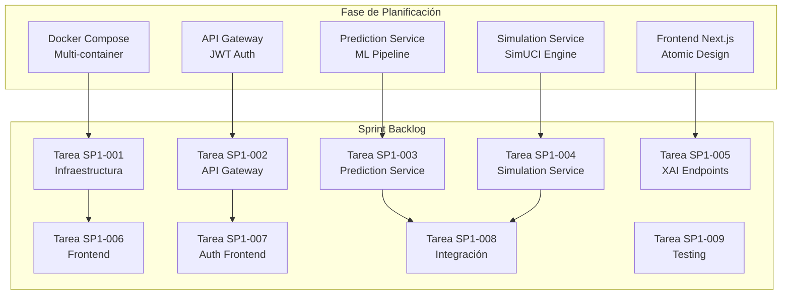
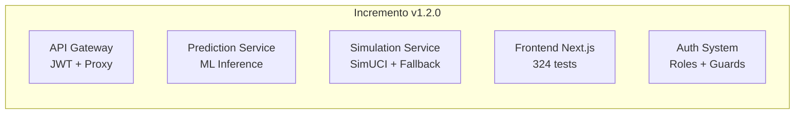
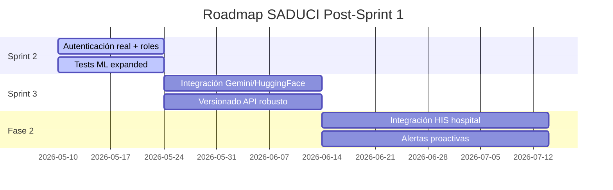

# Ejecución de Sprint 1 — SADUCI MVP

> Basado en hitos reales documentados en CHANGELOG.md de saduci-core y saduci-platform

---

## 1. Overview del Sprint

| Atributo | Valor |
|----------|-------|
| **Sprint** | 1 |
| **Objetivo** | Entregar MVP de predicción y simulación clínica |
| **Duración** | 4 semanas (~28 días) |
| **Fecha de inicio** | Basado en v1.0.0 (2024-01-15) |
| **Estado final** | Incremento de Software v1.2.0 (2026-03-16) |

---

## 2. Fase de Planificación

### 2.1 Objetivos del Sprint

1. Establecer infraestructura de microservicios con Docker Compose
2. Implementar autenticación JWT centralizada
3. Desplegar Prediction Service con modelo de mortalidad
4. Desplegar Simulation Service con SimUCI/fallback
5. Crear frontend web modular con React
6. Implementar sistema de explicaciones XAI
7. Configurar suite de tests automatizados

### 2.2 Artefactos Creados



---

## 3. Fase de Ejecución

### 3.1 Semana 1: Infraestructura Base

**Objetivo:** Establecer el esqueleto de microservicios

| Día | Actividad | Entregable |
|-----|-----------|-----------|
| 1-2 | Configurar Docker Compose | `docker-compose.yml` con 5 servicios |
| 3-4 | Implementar API Gateway base | FastAPI + endpoints de salud |
| 5 | Configurar PostgreSQL por servicio | Bases prediction-db y simulation-db |
| 6-7 | Health checks y networking | `depends_on: condition: service_healthy` |

**Comandos ejecutados:**
```bash
docker-compose up -d
curl http://localhost:8000/health
```

### 3.2 Semana 2: Autenticación y Prediction Service

**Objetivo:** Implementar seguridad y primera funcionalidad de ML

| Día | Actividad | Entregable |
|-----|-----------|-----------|
| 8-9 | Implementar autenticación JWT | `/auth/login`, generación de tokens |
| 10-11 | Cargar modelo `new_workflow.joblib` | Pipeline scikit-learn funcional |
| 12-13 | Implementar endpoint `/prediccion` | Predicción con probability + clase |
| 14 | Testing de Prediction Service | 137 tests (posteriormente reducidos) |

**Endpoint de prediccion implementado:**
```
POST /prediccion
Input: {edad, diag_ing1, diag_ing2, diag_egr2, apache, tiempo_vam}
Output: {probability, probability_percent, predicted_class, predicted_label, threshold}
```

### 3.3 Semana 3: Simulation Service y XAI

**Objetivo:** Completar servicios de simulación y explicabilidad

| Día | Actividad | Entregable |
|-----|-----------|-----------|
| 15-16 | Integrar SimUCI | `simuci.Experiment`, `single_run` |
| 17-18 | Implementar fallback determinista | SHA-256 seed para reproducibilidad |
| 19-20 | Implementar `/prediccion/explain` | SHAP, LIME, Gradientes Integrados |
| 21 | Pruebas estadísticas | Wilcoxon y Friedman endpoints |

**Mejoras implementadas (CHANGELOG v1.1.0):**
- Fallback SQLite con `StaticPool` para tests
- Fix de NaN serialization en Friedman
- Centriodes CSV para SimUCI

### 3.4 Semana 4: Frontend e Integración

**Objetivo:** Crear interfaz web modular

| Día | Actividad | Entregable |
|-----|-----------|-----------|
| 22-23 | Configurar Next.js 16 | App Router, React 19, TypeScript |
| 24-25 | Implementar Atomic Design | 40+ atoms, molecules, organisms |
| 26-27 | Integrar endpoints | API routes conectadas a microservicios |
| 28 | Testing completo | 265+ tests pasando |

**Hitos del changelog (2026-03-16):**
- Estandarización de dominio `prediccion` → `prediction`
- Navbar con estados activos para ancestros
- Rol ADMIN en mayúsculas para UI consistente

---

## 4. Fase de Revisión (Sprint Review)

### 4.1 Incremento de Software Resultante



### 4.2 Métricas del Sprint

| Métrica | Valor | Estado |
|---------|-------|--------|
| Tests pasando (frontend) | 324 | ✓ |
| Health checks | 3/3 servicios | ✓ |
| Endpoints públicos | 8 | ✓ |
| Endpoints protegidos | 5 | ✓ |
| Cobertura de componentes | >300 | ✓ |
| Lint errors | 0 | ✓ |

### 4.3 Funcionalidades Entregadas

**Del backlog priorizado:**

| HU | Funcionalidad | Estado | Sprint |
|----|---------------|--------|--------|
| HU-001 | Predicción de mortalidad | ✓ Completada | Sprint 1 |
| HU-002 | Explicabilidad (XAI) | ✓ Completada | Sprint 1 |
| HU-003 | Autenticación JWT | ✓ Completada | Sprint 1 |
| HU-004 | Simulación clínica | ✓ Completada | Sprint 1 |
| HU-005 | Gestión de usuarios | ✓ Completada | Sprint 1 |
| HU-006 | Narrativas clínicas | ✓ Completada (stub) | Sprint 1 |
| HU-007 | Pruebas estadísticas | ✓ Completada | Sprint 1 |
| HU-008 | Visualización de datos | ✓ Completada | Sprint 1 |

### 4.4 Limitaciones Conocidas (v1.2.0)

Del CHANGELOG.md v1.0.0:
- Modelo de autenticación orientado a demostración (demo credentials)
- Lógica ML en etapa temprana (dummy model strategy en v1.0.0)
- Estrategia de versionado de API no completamente madurada

---

## 5. Fase de Retrospectiva

### 5.1 Lo que funcionó bien

1. **Arquitectura de microservicios**: La separación de Prediction y Simulation Services permitió desarrollo paralelo
2. **Docker Compose con health checks**: La estrategia de `service_healthy` garantizó arranque ordenado
3. **Fallback determinista**: La implementación de SHA-256 seed eliminó no-determinismo en tests
4. **Atomic Design en frontend**: Componentes reutilizables aceleraron el desarrollo

### 5.2 Áreas de mejora

1. **Testing suite**: La suite inicial de 137 tests fue retirada y reconstruida
2. **Documentación**: Reducción de docs a solo ARCHITECTURE.md y CHANGELOG.md para evitar desvío
3. **Nomenclatura**: Normalización tardía de `prediccion` → `prediction`

### 5.3 Acciones para Sprint 2

| Acción | Prioridad | owners |
|--------|-----------|--------|
| Expandir suite de tests para ML | Alta | Backend team |
| Implementar autenticación real | Alta | Security team |
| Integrar proveedores de narrativa (Gemini) | Media | ML team |
| Mejorar versionado de API | Media | Backend team |

---

## 6. Roadmap Post-Sprint 1


