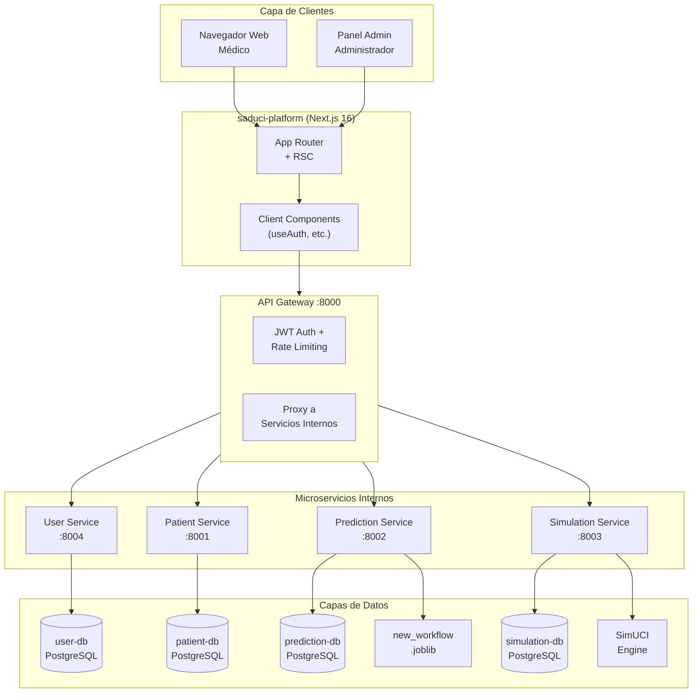
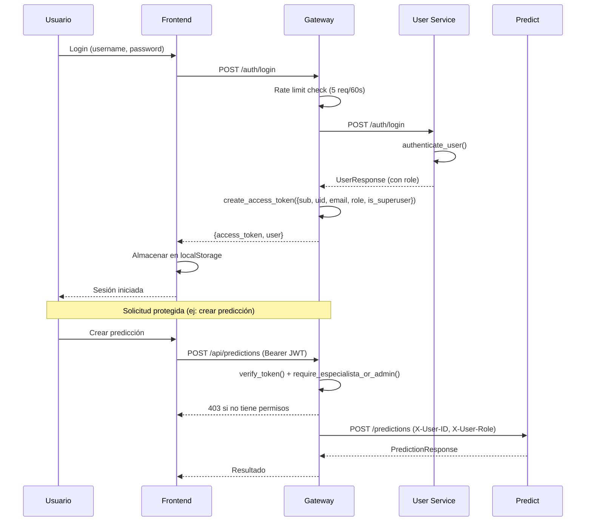
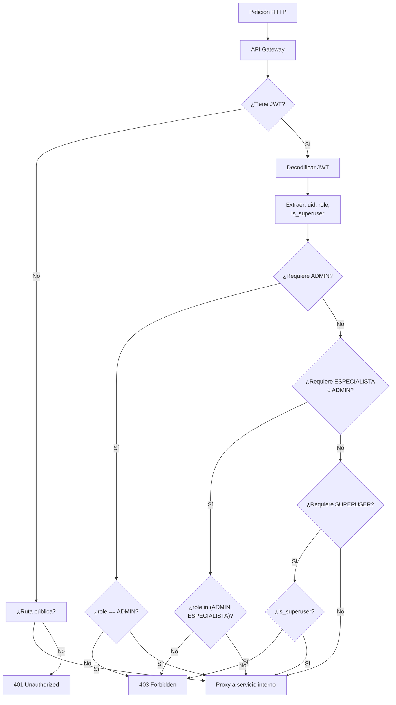

# PROMPT MAESTRO CONSOLIDADO — Capítulo 3: Implementación y Cierre (SADUCI)

> Documento único que contiene TODA la información necesaria para que un modelo de lenguaje (LLM) redacte el Capítulo 3 completo de la tesis SADUCI, enfocado en la implementación final del sistema, la reestructuración del backend, el módulo de usuarios y el cierre de la investigación.

---

## INSTRUCCIONES DE USO

Este prompt debe proporcionarse completo a un LLM para generar el capítulo. El capítulo debe:
1. Estar en español
2. Seguir formato APA 7 para citas
3. Usar la estructura formal detallada en la sección 2
4. Integrar todos los diagramas Mermaid
5. Reflejar el estado FINAL del software (no la versión inicial del Capítulo 2)

---

## CONTEXTO DEL PROYECTO

**SADUCI** (Sistema de Ayuda a la Decisión en la Unidad de Cuidados Intensivos) es una plataforma web modular para el Hospital Universitario Arnaldo Milián Castro. Ayuda al personal clínico en la toma de decisiones mediante predicción clínica, simulación y análisis estadístico basados en inteligencia artificial para la UCI.

### Stack Tecnológico Final

**Frontend** (saduci-platform):
- Next.js 16.1.6 + React 19.2.3
- Bun 1.3+ (runtime, bundler, test runner)
- Tailwind CSS v4, Recharts, @tanstack/react-table, react-icons
- Atomic Design: atoms, molecules, organisms, layouts
- Testing: Bun test + Happy DOM + React Testing Library

**Backend** (saduci-core):
- FastAPI (Python) para API Gateway
- 5 microservicios con PostgreSQL (Database per Service)
- scikit-learn 1.6.1 + imbalanced-learn (ML)
- joblib (serialización de modelos entrenados)
- SimUCI (motor de simulación, opcional con fallback determinista SHA-256)
- JWT para autenticación stateless
- Alembic para migraciones de base de datos

**Infraestructura**:
- Docker + Docker Compose (8 contenedores)
- Health checks por servicio
- Red interna Docker para aislamiento
- Rate limiting en login (5 req/60s)

---

## ESTRUCTURA FORMAL DEL CAPÍTULO 3

```
Capítulo 3: Implementación y Resultados

3.1 Introducción
  3.1.1 Contexto del capítulo
  3.1.2 Evolución desde el diseño inicial

3.2 Reestructuración del Backend
  3.2.1 De 3 a 5 microservicios: justificación
  3.2.2 Servicio de Usuarios (User Service)
  3.2.3 Servicio de Pacientes (Patient Service)
  3.2.4 API Gateway mejorado
  3.2.5 Diagrama de arquitectura final
  3.2.6 Stack tecnológico final

3.3 Módulo de Usuarios y Control de Acceso
  3.3.1 Modelo de roles: ADMIN, ESPECIALISTA, MEDICO
  3.3.2 Permisos por rol y recursos protegidos
  3.3.3 Autenticación JWT con claims enriquecidos
  3.3.4 Política de contraseñas y seed data
  3.3.5 Protección de rutas en frontend

3.4 Modelo de Datos Final
  3.4.1 user-db: tabla users con roles
  3.4.2 patient-db: tabla patients
  3.4.3 prediction-db: predictions + prediction_explanations
  3.4.4 simulation-db: simulations + statistical_tests
  3.4.5 Integridad referencial y tracking de usuario

3.5 Contratos de API Finales
  3.5.1 Endpoints de autenticación
  3.5.2 Endpoints de gestión de usuarios
  3.5.3 Endpoints de pacientes
  3.5.4 Endpoints de predicciones
  3.5.5 Endpoints de simulaciones
  3.5.6 Endpoints de pruebas estadísticas

3.6 Implementación Frontend
  3.6.1 Gestión de usuarios: panel administrador
  3.6.2 Registro de predicciones y simulaciones
  3.6.3 Sistema de permisos en interfaz
  3.6.4 Páginas de registros (CRUD)

3.7 Discusión y Cierre
  3.7.1 Cumplimiento de requisitos
  3.7.2 Limitaciones identificadas
  3.7.3 Trabajo futuro
  3.7.4 Conclusiones
```

---

## CONTENIDO DETALLADO POR SECCIÓN

### 3.2 REESTRUCTURACIÓN DEL BACKEND

**Arquitectura Inicial (Capítulo 2)**:
- 3 servicios: API Gateway (:8000), Prediction (:8002), Simulation (:8003)
- 2 bases de datos: prediction-db, simulation-db
- Tabla users embebida en prediction-db
- Roles: solo is_superuser (booleano)

**Arquitectura Final (Capítulo 3)**:
- 5 servicios: API Gateway (:8000), Patient (:8001), Prediction (:8002), Simulation (:8003), User (:8004)
- 5 bases de datos independientes: user-db, patient-db, prediction-db, simulation-db
- Cada servicio con su propia base PostgreSQL y esquema desacoplado
- 8 contenedores Docker en total (5 servicios + 3 bases de datos)

**Nuevos Servicios**:

| Servicio | Puerto | Base de Datos | Responsabilidad |
|----------|--------|---------------|-----------------|
| API Gateway | 8000 | — (proxy) | JWT auth, rate limiting, enrutamiento, CORS |
| Patient Service | 8001 | patient-db | Registro de pacientes (MRN, datos demográficos) |
| Prediction Service | 8002 | prediction-db | Inferencia ML, explicabilidad, narrativas |
| Simulation Service | 8003 | simulation-db | Simulación clínica, pruebas estadísticas |
| User Service | 8004 | user-db | Gestión de usuarios, autenticación, roles |

**Mejoras del API Gateway**:
- 4 ServiceClients para comunicación asíncrona con servicios internos
- Headers de tracking: `X-User-ID`, `X-User-Role`, `X-User-Username`
- Rate limiting en login: máximo 5 intentos por 60 segundos por IP
- CORS configurable para múltiples orígenes
- Manejo de errores upstream con extracción de detalles
- Dependencias de autorización:
  - `get_current_user`: cualquier usuario autenticado
  - `require_admin`: solo ADMIN
  - `require_superuser`: solo superusuarios
  - `require_especialista_or_admin`: ADMIN o ESPECIALISTA

### 3.3 MÓDULO DE USUARIOS Y CONTROL DE ACCESO

**Modelo User (`users` tabla)**:

| Campo | Tipo | Restricciones |
|-------|------|---------------|
| id | Integer | PK, auto-increment, indexed |
| username | String(150) | UNIQUE, NOT NULL, indexed |
| email | String(255) | UNIQUE, NOT NULL, indexed |
| hashed_password | String(255) | NOT NULL (pbkdf2_sha256) |
| role | String(50) | NOT NULL, default: MEDICO, indexed |
| is_active | Boolean | NOT NULL, default: True |
| created_at | DateTime(tz) | NOT NULL, default: utcnow |
| updated_at | DateTime(tz) | NOT NULL, default: utcnow, onupdate |

**UserRole Enum**:
```
ADMIN        → Acceso total, CRUD de usuarios
ESPECIALISTA → Puede crear predicciones y simulaciones
MEDICO       → Solo lectura (default)
```

**Permisos en Backend**:
| Recurso | ADMIN | ESPECIALISTA | MEDICO |
|---------|-------|-------------|--------|
| CRUD usuarios | ✓ | ✗ | ✗ |
| Crear predicción | ✓ | ✓ | ✗ |
| Ver predicciones | ✓ | ✓ | ✓ |
| Crear simulación | ✓ | ✓ | ✗ |
| Ver simulaciones | ✓ | ✓ | ✓ |
| Pruebas estadísticas | ✓ | ✓ | ✗ |
| Admin endpoints | ✓ | ✗ | ✗ |

**Permisos en Frontend** (`recordPermissions.ts`):
| Recurso | Administrador | Especialista | Médico |
|---------|--------------|-------------|--------|
| Simulations | CRUD completo | Crear, editar, ver. No eliminar | Solo lectura |
| Predictions | CRUD completo | CRUD completo | Solo lectura |
| Statistics | CRUD completo | CRUD completo | Solo lectura |

**Flujo de Autenticación**:
```
1. POST /auth/login → gateway valida con user service
2. Gateway genera JWT con: sub, uid (user_id), email, role, is_superuser, exp
3. Cliente almacena token en localStorage (clave: saduci_token)
4. Peticiones subsiguientes incluyen Authorization: Bearer <token>
5. Gateway decodifica JWT y aplica dependencias de autorización
```

**Seed Data** (se crea automáticamente si la tabla está vacía):
- 1 usuario ADMIN desde variables de entorno `AUTH_USERNAME`/`AUTH_PASSWORD`
- analista1 (ESPECIALISTA) / password123
- analista2 (ESPECIALISTA) / password123
- doctor (MEDICO) / doctor123

**Política de Contraseñas**:
- Mínimo 8 caracteres
- Hash con passlib pbkdf2_sha256
- No se devuelven en respuestas API
- Cambio requiere contraseña actual

### 3.4 MODELO DE DATOS FINAL

#### user-db (User Service)

**Tabla `users`**:
- id (PK, Integer), username (UNIQUE), email (UNIQUE), hashed_password
- role (ADMIN|ESPECIALISTA|MEDICO), is_active
- created_at, updated_at

#### patient-db (Patient Service)

**Tabla `patients`**:
- id (PK, Integer), mrn (UNIQUE, Medical Record Number)
- first_name, last_name, date_of_birth, sex
- created_at, updated_at

#### prediction-db (Prediction Service)

**Tabla `predictions`**:
- id (PK, Integer), patient_id (indexed), model_name
- features (JSON), prediction (JSON), confidence (Float, nullable)
- user_id (Integer, nullable, indexed) — tracking de quién creó la predicción
- created_at

#### simulation-db (Simulation Service)

**Tabla `simulations`**:
- id (PK, Integer), patient_id (indexed), scenario
- parameters (JSON), results (JSON)
- user_id (Integer, nullable, indexed) — tracking de quién creó la simulación
- created_at

**Tabla `statistical_tests`** (cuando se persisten resultados):
- id (PK), test_name (wilcoxon|friedman), samples (JSON)
- statistic, p_value, interpretation, created_at

### 3.5 CONTRATOS DE API FINALES

#### Endpoints Públicos (sin JWT)
| Método | Ruta | Descripción |
|--------|------|-------------|
| GET | `/health` | Health check del gateway |
| POST | `/auth/login` | Login (rate-limited) |
| POST | `/auth/register` | Registro de nuevo usuario |
| POST | `/prediction` | Predicción de mortalidad (platform) |
| POST | `/prediction/explain` | Predicción con explicabilidad |
| POST | `/prediccion` | Alias español de /prediction |
| POST | `/prediccion/explain` | Alias español de /prediction/explain |
| POST | `/simulation` | Simulación clínica (platform) |
| POST | `/statistics/wilcoxon` | Prueba de Wilcoxon |
| POST | `/statistics/friedman` | Prueba de Friedman |

#### Endpoints Autenticados (JWT requerido)
| Método | Ruta | Auth | Descripción |
|--------|------|------|-------------|
| GET | `/auth/me` | Cualquiera | Obtener usuario actual |
| POST | `/auth/change-password` | Cualquiera | Cambiar contraseña |
| POST | `/api/predictions` | ADMIN/ESPECIALISTA | Crear predicción |
| GET | `/api/predictions/models` | Cualquiera | Listar modelos |
| GET | `/api/predictions/{patient_id}` | Cualquiera | Historial de predicciones |
| POST | `/api/simulations` | ADMIN/ESPECIALISTA | Crear simulación |
| GET | `/api/simulations/scenarios` | Cualquiera | Listar escenarios |
| GET | `/api/simulations/{patient_id}` | Cualquiera | Historial de simulaciones |
| POST | `/api/simulations/icu` | ADMIN/ESPECIALISTA | Simulación UCI |
| POST | `/api/patients` | ADMIN/ESPECIALISTA | Crear paciente |
| GET | `/api/patients/{mrn}` | Cualquiera | Obtener paciente |
| PUT | `/api/patients/{mrn}` | ADMIN/ESPECIALISTA | Actualizar paciente |

#### Endpoints de Usuarios (Admin-only)
| Método | Ruta | Auth | Descripción |
|--------|------|------|-------------|
| POST | `/api/users` | ADMIN | Crear usuario |
| GET | `/api/users` | ADMIN | Listar usuarios (filtro ?role=) |
| GET | `/api/users/{id}` | Cualquiera | Obtener usuario por ID |
| PUT | `/api/users/{id}` | ADMIN | Actualizar usuario |
| DELETE | `/api/users/{id}` | ADMIN | Eliminar usuario |
| GET | `/admin/users` | SUPERUSER | Listar todos los usuarios |
| POST | `/admin/users` | SUPERUSER | Crear usuario (admin) |
| DELETE | `/admin/users/{user_id}` | SUPERUSER | Eliminar usuario (sin autoborrado) |

#### Ejemplo POST /api/predictions (autenticado)
```json
// Request (con JWT en header)
{
  "patient_id": "P001",
  "model_name": "mortality_risk",
  "features": { "edad": 65, "apache": 25, "diag_ing1": 5, ... }
}

// Response
{
  "patient_id": "P001",
  "model_name": "mortality_risk",
  "prediction": { "probability": 0.73, "predicted_class": 1, "predicted_label": "muere" },
  "confidence": 0.85,
  "timestamp": "2026-06-21T12:00:00Z",
  "user_id": 1
}
```

### 3.6 IMPLEMENTACIÓN FRONTEND

**Gestión de Usuarios** (`/admin/users`):
- Página protegida solo para administradores
- Lista de usuarios con badges de rol (Admin = púrpura, Otros = azul)
- Estado activo/inactivo con badges verdes/rojos
- Formulario inline de creación (username, email, password, is_admin checkbox, is_active checkbox)
- Botón de eliminar con confirmación (no permite autoborrado)
- Consume `/api/admin/users` con token JWT de localStorage

**Registro de Predicciones/Simulaciones** (`/registros/`):
- Tres subpáginas: simulaciones, predicciones, estadísticas
- Tablas con datos mapeados desde el backend
- Permisos contextuales: acciones habilitadas/deshabilitadas según rol
- `RecordActionsCell` respeta `RecordPermissions`

**Settings** (`/settings`):
- Visualización del perfil: avatar, nombre, email, rol
- Cambio de contraseña con validación de mín 8 caracteres y confirmación

**Auth Context** (`src/lib/auth.tsx`):
- Provider React que gestiona: user, token, isAuthenticated, isLoading
- Login: POST /api/auth/login → almacena token y user en localStorage
- Register: POST /api/auth/register → auto-login tras registro exitoso
- Logout: limpia localStorage y estado
- Hydration: valida token existente en montaje via GET /auth/me
- `mapBackendUser()`: normaliza roles del backend al frontend
- `normalizeRole()`: maneja variantes de rol (admin, Administrador, SYSTEM ADMIN, Medico, etc.)

---

## DIAGRAMAS MERMAID A INTEGRAR

### Diagrama de arquitectura final (5 servicios)


### Diagrama de secuencia de autenticación con roles


### Diagrama de flujo de permisos


---

## CITAS OBLIGATORIAS

**Citas en texto (APA 7)**:
1. Shortliffe & Cimino (2014): Base de CDSS
2. Sutton et al. (2020): Taxonomía funcional de CDSS
3. IEEE 830-1998: Estándar de especificación de requisitos
4. Schwaber & Sutherland (2020): Scrum Guide
5. Newman (2021): Building Microservices (patrones de microservicios)
6. Richardson (2018): API Gateway Pattern, Database per Service

**Formato de referencias**:
```
Newman, S. (2021). Building microservices: Designing fine-grained systems
(2nd ed.). O'Reilly Media.

Richardson, C. (2018). Microservices patterns: With examples in Java.
Manning Publications.
```

---

## VERIFICACIÓN FINAL

- [ ] Nombre "SADUCI" consistente
- [ ] Citas APA 7 correctas
- [ ] Diagramas Mermaid compilan
- [ ] Roles y permisos claramente definidos
- [ ] Diferencia entre arquitectura inicial (Cap. 2) y final (Cap. 3) explicada
- [ ] No hay referencias a archivos internos del repositorio
- [ ] Vocabulario técnico consistente
- [ ] Todos los endpoints documentados con autenticación
- [ ] Flujo de autenticación completo explicado
