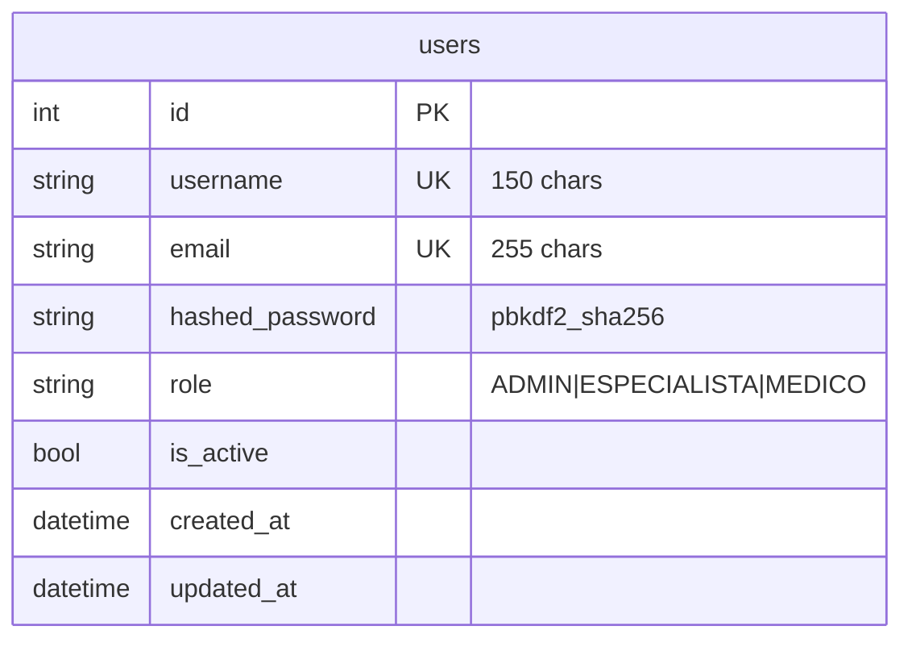
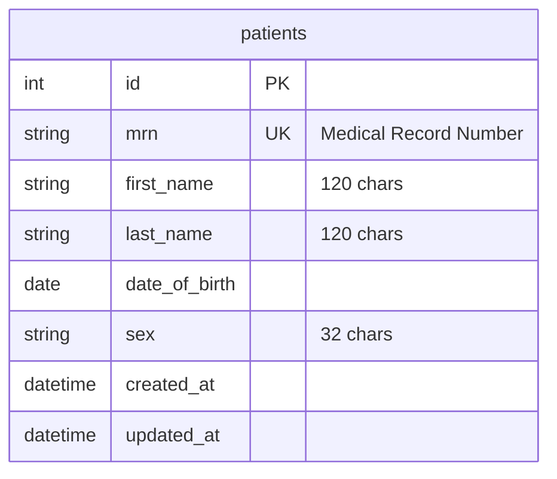
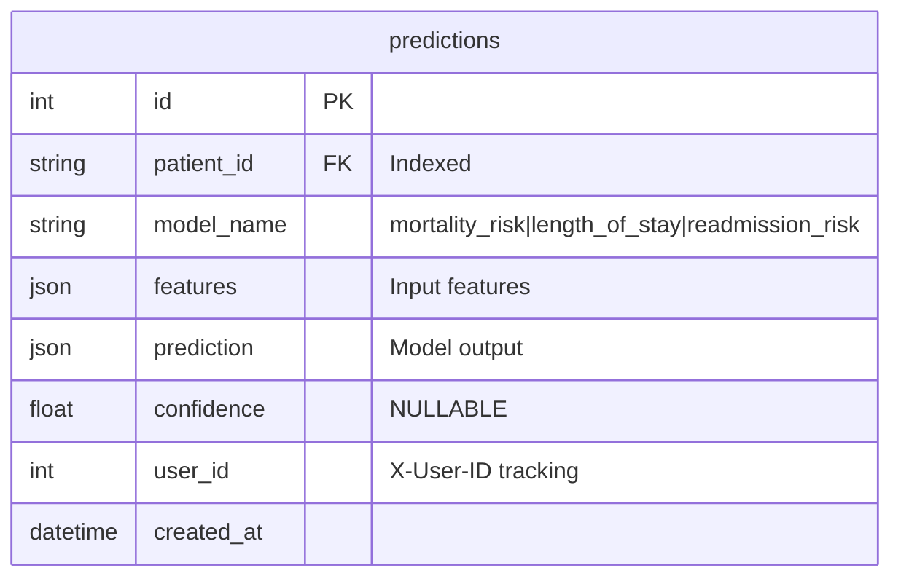
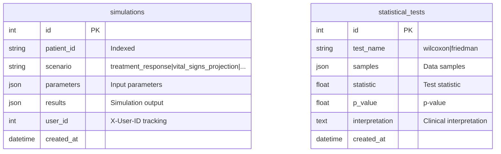
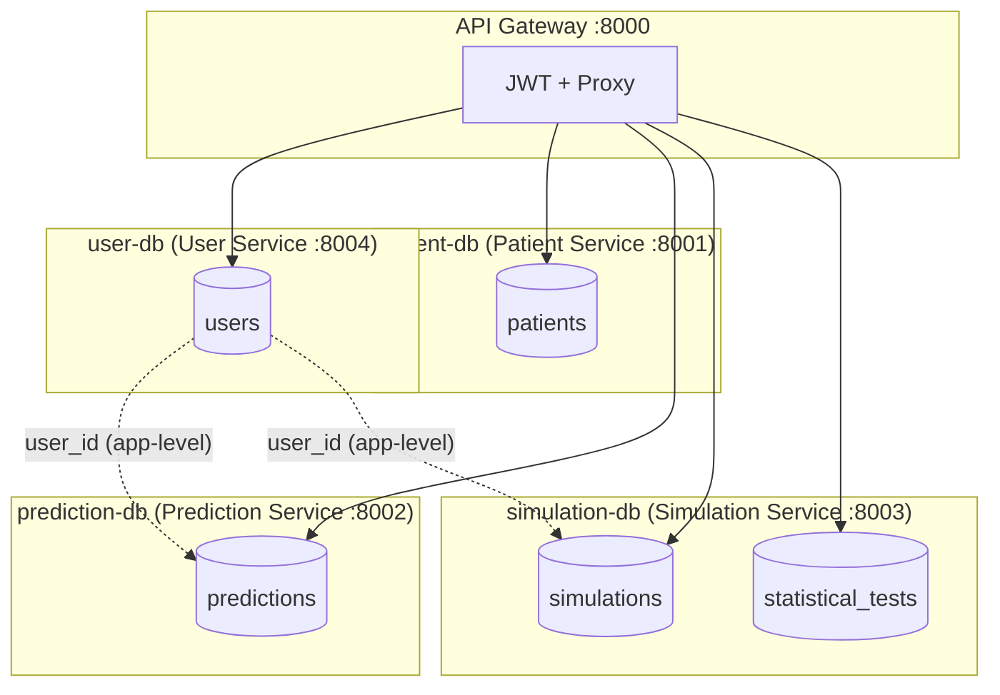

# Modelo de Datos Final — SADUCI

## 1. Visión General

El modelo de datos final de SADUCI sigue el patrón **Database per Service** con 5 bases de datos independientes, cada una propiedad de un microservicio específico. Este diseño garantiza desacoplamiento total entre dominios, evolución independiente de esquemas y aislamiento de fallos.

### Bases de Datos

| Base de Datos | Propietario | Propósito |
|--------------|-------------|-----------|
| `user-db` | User Service (:8004) | Usuarios, autenticación, roles |
| `patient-db` | Patient Service (:8001) | Registro de pacientes |
| `prediction-db` | Prediction Service (:8002) | Predicciones y explicaciones |
| `simulation-db` | Simulation Service (:8003) | Simulaciones y pruebas estadísticas |

---

## 2. user-db (User Service)

### Tabla: `users`

| Columna | Tipo | Restricciones | Descripción |
|---------|------|---------------|-------------|
| `id` | Integer | PK, auto-increment, indexed | Identificador único del usuario |
| `username` | String(150) | UNIQUE, NOT NULL, indexed | Nombre de usuario para login |
| `email` | String(255) | UNIQUE, NOT NULL, indexed | Correo electrónico |
| `hashed_password` | String(255) | NOT NULL | Hash de contraseña (pbkdf2_sha256) |
| `role` | String(50) | NOT NULL, default: 'MEDICO', indexed | Rol del usuario |
| `is_active` | Boolean | NOT NULL, default: True | Estado de la cuenta |
| `created_at` | DateTime(tz) | NOT NULL, default: utcnow | Fecha de creación |
| `updated_at` | DateTime(tz) | NOT NULL, default: utcnow, onupdate | Última actualización |

**Índices:**
- `ix_users_username` ON (username) UNIQUE
- `ix_users_email` ON (email) UNIQUE
- `ix_users_role` ON (role)

### Diagrama ER

---

## 3. patient-db (Patient Service)

### Tabla: `patients`

| Columna | Tipo | Restricciones | Descripción |
|---------|------|---------------|-------------|
| `id` | Integer | PK, auto-increment, indexed | Identificador único |
| `mrn` | String(64) | UNIQUE, NOT NULL, indexed | Medical Record Number |
| `first_name` | String(120) | NOT NULL | Nombre del paciente |
| `last_name` | String(120) | NOT NULL | Apellidos del paciente |
| `date_of_birth` | Date | NOT NULL | Fecha de nacimiento |
| `sex` | String(32) | NOT NULL | Sexo |
| `created_at` | DateTime(tz) | NOT NULL, default: utcnow | Fecha de creación |
| `updated_at` | DateTime(tz) | NOT NULL, default: utcnow, onupdate | Última actualización |

---

## 4. prediction-db (Prediction Service)

### Tabla: `predictions`

| Columna | Tipo | Restricciones | Descripción |
|---------|------|---------------|-------------|
| `id` | Integer | PK, auto-increment, indexed | Identificador único |
| `patient_id` | String | NOT NULL, indexed | ID del paciente |
| `model_name` | String | NOT NULL | Nombre del modelo (mortality_risk, etc.) |
| `features` | JSON | NOT NULL | Features de entrada serializadas |
| `prediction` | JSON | NOT NULL | Resultado de la predicción |
| `confidence` | Float | NULLABLE | Nivel de confianza |
| `user_id` | Integer | NULLABLE, indexed | Usuario que creó la predicción |
| `created_at` | DateTime | default: utcnow | Fecha de creación |

**Nota:** `user_id` permite tracking de quién realizó cada predicción, vinculando con la tabla `users` en user-db a nivel de aplicación.

---

## 5. simulation-db (Simulation Service)

### Tabla: `simulations`

| Columna | Tipo | Restricciones | Descripción |
|---------|------|---------------|-------------|
| `id` | Integer | PK, auto-increment, indexed | Identificador único |
| `patient_id` | String | NOT NULL, indexed | ID del paciente |
| `scenario` | String | NOT NULL | Escenario simulado |
| `parameters` | JSON | NOT NULL | Parámetros de entrada |
| `results` | JSON | NOT NULL | Resultados de la simulación |
| `user_id` | Integer | NULLABLE, indexed | Usuario que creó la simulación |
| `created_at` | DateTime | default: utcnow | Fecha de creación |

### Tabla: `statistical_tests`

| Columna | Tipo | Restricciones | Descripción |
|---------|------|---------------|-------------|
| `id` | Integer | PK, auto-increment | Identificador único |
| `test_name` | String | NOT NULL | wilcoxon | friedman |
| `samples` | JSON | NOT NULL | Muestras analizadas |
| `statistic` | Float | NOT NULL | Valor del estadístico |
| `p_value` | Float | NOT NULL | P |
| `interpretation` | Text | NULLABLE | Interpretación del resultado |
| `created_at` | DateTime | default: utcnow | Fecha de creación |

---

## 6. Diagrama General de Relaciones

**Nota:** Las relaciones entre `users` y `predictions`/`simulations` se manejan a nivel de aplicación mediante el header `X-User-ID`, respetando el patrón Database per Service. No existen foreign keys entre bases de datos diferentes.

---

## 7. Esquemas Pydantic (Validación)

### 7.1 User Schemas

| Schema | Campos | Uso |
|--------|--------|-----|
| `UserBase` | email, username, role, is_active | Base |
| `UserCreate` | + password | Creación admin |
| `RegisterRequest` | email, username, password | Registro público |
| `UserUpdate` | email?, role?, is_active? | Actualización |
| `UserResponse` | + id, created_at, updated_at | Respuesta API |

### 7.2 Prediction Schemas

| Schema | Campos Clave |
|--------|-------------|
| `PlatformPredictionRequest` | edad (14-61), diag_ing1 (1-20), diag_ing2 (39-173), diag_egr2 (18-40), apache (18-40), tiempo_vam (18-40) |
| `PlatformPredictionResponse` | probability, probability_percent, predicted_class, predicted_label ("vive"/"muere"), threshold |
| `PlatformExplanationRequest` | + method (LIME/SHAP/...), include_narrative, ai_provider |
| `PlatformExplanationResponse` | + method, rows[], narrative |
| `PredictionRequest` | patient_id, model_name, features (dict) |

### 7.3 Simulation Schemas

| Schema | Campos Clave |
|--------|-------------|
| `ICUPatientSimulationRequest` | patient_id, age (14-100), apache (0-70), uti_stay (1-8760h), n_replications (1-1000) |
| `ICUPatientSimulationResponse` | patient_id, simulation_results, statistics, user_id |
| `PlatformSimulationRequest` | age, apache, d1-d4, artif_vent, vam_time, uti_stay, n_runs (50-100000) |
| `TimeStats` | mean, std, ci_lower, ci_upper (95%) |

### 7.4 Statistics Schemas

| Schema | Campos |
|--------|--------|
| `WilcoxonRequest` | x (List[float]), y (List[float]) |
| `FriedmanRequest` | samples (List[List[float]]) |
| `StatisticalTestResult` | statistic, p_value |

---

## 8. Reglas de Validación Clínicas

| Campo | Regla | Código |
|-------|-------|--------|
| Edad | 14 ≤ edad ≤ 100 | Pydantic Field(ge=14, le=100) |
| APACHE II | 0 ≤ apache ≤ 70 | Pydantic Field(ge=0, le=70) |
| Estancia UCI | 1 ≤ uti_stay ≤ 8760 horas | Pydantic Field(ge=1, le=8760) |
| VM | 0 ≤ vam_time ≤ 8760 horas | Pydantic Field(ge=0, le=8760) |
| Replicaciones | 1 ≤ n_replications ≤ 1000 | Pydantic Field(ge=1, le=1000) |
| Contraseña | Longitud ≥ 8 caracteres | Validación explícita |
